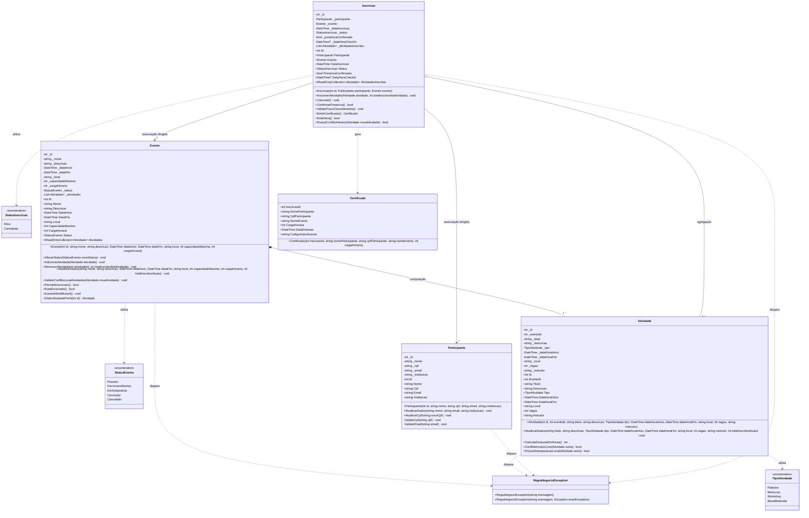

# Documento de Design de Software: Diagrama de Classes de Projeto (DCD)
## Solução: SistemaGestaoEventosAcademicos

---

### Histórico de Revisões
| Data | Versão | Descrição | Autor |
| :--- | :--- | :--- | :--- |
| 12/11/2026 | 1.0 | Elaboração do Diagrama de Classes de Projeto (DCD) da Camada de Negócio e Arquitetura Completa, Dicionário Técnico de Classes/Métodos e Rastreabilidade com as 25 Regras de Negócio (RN01 a RN25). | Engenharia de Software |

---

## 1. Introdução e Diretrizes de Design Orientado a Objetos

Este documento estabelece o **Diagrama de Classes de Projeto (DCD — Design Class Diagram)** do **Sistema de Gestão de Eventos Acadêmicos**, servindo como especificação executiva e blueprint técnico definitivo para a fase de codificação em C# (.NET 8+).

O modelo foi projetado sob os fundamentos da **Programação Orientada a Objetos (POO)** e boas práticas de engenharia de software:

1. **Arquitetura em Três Camadas com Dependência Unidirecional:**
   - `SistemaGestaoEventosAcademicos.Apresentacao` (Console CLI): depende de `Negocio` e `Persistencia`.
   - `SistemaGestaoEventosAcademicos.Persistencia` (Repositórios em Memória): depende exclusivamente de `Negocio`.
   - `SistemaGestaoEventosAcademicos.Negocio` (Núcleo de Domínio Puro): isolado, sem nenhuma dependência de bibliotecas externas, persistência ou UI.

```text
┌────────────────────────────────────────────────────────┐
│      SistemaGestaoEventosAcademicos.Apresentacao       │
│               (Console CLI / Menus)                    │
└───────────────┬────────────────────────┬───────────────┘
                │                        │
                ▼                        ▼
┌──────────────────────────┐   ┌─────────────────────────┐
│ ...Persistencia          │   │ ...Negocio              │
│ (Repositórios em Memória)│──>│ (Entidades Ricas, Enums,│
│                          │   │  Exceções de Domínio)   │
└──────────────────────────┘   └─────────────────────────┘
```

2. **Modelo de Domínio Rico (*Rich Domain Model*) vs. Modelo Anêmico:**
   - As entidades (`Evento`, `Atividade`, `Participante`, `Inscricao`) contêm seus próprios dados e a lógica comportamental que os manipula.
   - Toda alteração de estado é realizada através de métodos expressivos de negócio (ex.: `AlterarStatus()`, `AdicionarAtividade()`, `ConfirmarPresenca()`, `Cancelar()`), garantindo que uma entidade nunca permaneça em estado inconsistente.

3. **Encapsulamento Estrito e Imutabilidade Controlada:**
   - Campos de estado internos utilizam modificador `private` com convenção de nomenclatura `_camelCase`.
   - Propriedades expõem `get` público e `private set` (ou `init`), impedindo alterações externas arbitrárias.
   - Coleções internas do tipo `List<T>` nunca são expostas diretamente como mutáveis; são expostas externamente através de `IReadOnlyCollection<T>` (`AsReadOnly()`).

4. **Invariantes e Validações Imediatas via Construtores:**
   - Construtores exigem todos os dados essenciais para a existência da entidade e realizam a validação imediata das invariantes de domínio.
   - Falhas de invariante disparam a exceção de domínio personalizada `RegraNegocioException`.

5. **Tratamento de Exceções de Domínio:**
   - A classe `RegraNegocioException` é a única via utilizada pelas entidades do núcleo de negócio para comunicar violações das 25 Regras de Negócio (RN01 a RN25), permitindo que a camada de apresentação capture e informe o usuário sem que ocorra encerramento abrupto do software (*fail-safe*).

---

## 2. Diagrama de Classes de Projeto — Camada de Negócio (`SistemaGestaoEventosAcademicos.Negocio`)

O diagrama a seguir especifica o núcleo de domínio, seus atributos tipados em C#, modificadores de acesso, assinaturas de métodos e os relacionamentos formais de POO:
- **Composição estrita (`Evento *-- Atividade`):** O ciclo de vida de `Atividade` é integralmente vinculado ao de seu `Evento` pai.
- **Associação dirigida (`Inscricao --> Participante`, `Inscricao --> Evento`):** A inscrição conhece o participante e o evento aos quais pertence.
- **Agregação (`Inscricao o-- Atividade`):** A inscrição mantém referência às atividades selecionadas pelo participante dentro daquele evento.
- **Dependência (`..>`):** Uso de enums e lançamento de `RegraNegocioException`.



---

## 3. Diagrama de Classes da Arquitetura Completa (Integração das 3 Camadas)

O diagrama a seguir exibe como as três camadas se articulam sem que haja violação de acoplamento:
- A camada de **Apresentação** gerencia a interação via terminal CLI e coordena as chamadas aos **Repositórios** e às **Entidades de Negócio**.
- A camada de **Persistência** isola os repositórios em memória, gerenciando coleções `List<T>` internas e métodos de consulta otimizados.
- A camada de **Negócio** permanece agnóstica e protegida contra dependências externas.

```mermaid
classDiagram
    direction TB

    namespace Apresentacao {
        class Program {
            +Main(string[] args)$ void
        }
        class ConsoleHelper {
            +LerTextoObrigatorio(string prompt)$ string
            +LerTextoOpcional(string prompt, string valorPadrao)$ string
            +LerInteiroPositivo(string prompt)$ int
            +LerDataHora(string prompt)$ DateTime
            +ExibirTitulo(string titulo)$ void
            +ExibirMensagemSucesso(string mensagem)$ void
            +ExibirMensagemErro(string mensagem)$ void
            +ExibirMensagemAlerta(string mensagem)$ void
            +ConfirmarAcao(string prompt)$ bool
            +Pausar()$ void
        }
        class MenuPrincipal {
            -EventoRepositorio _eventoRepo
            -ParticipanteRepositorio _participanteRepo
            -InscricaoRepositorio _inscricaoRepo
            +MenuPrincipal(EventoRepositorio evRepo, ParticipanteRepositorio partRepo, InscricaoRepositorio inscRepo)
            +ExibirMenu() void
        }
        class MenuEventos {
            -EventoRepositorio _eventoRepo
            -InscricaoRepositorio _inscricaoRepo
            +MenuEventos(EventoRepositorio eventoRepo, InscricaoRepositorio inscricaoRepo)
            +ExibirMenu() void
            -CadastrarEvento() void
            -ListarEventos() void
            -AlterarDadosEvento() void
            -GerenciarStatusEvento() void
            -GerenciarAtividades(Evento evento) void
        }
        class MenuParticipantes {
            -ParticipanteRepositorio _participanteRepo
            +MenuParticipantes(ParticipanteRepositorio participanteRepo)
            +ExibirMenu() void
            -CadastrarParticipante() void
            -ListarParticipantes() void
            -BuscarParticipantePorCpf() void
            -AtualizarParticipante() void
        }
        class MenuInscricoes {
            -InscricaoRepositorio _inscricaoRepo
            -EventoRepositorio _eventoRepo
            -ParticipanteRepositorio _participanteRepo
            +MenuInscricoes(InscricaoRepositorio inscRepo, EventoRepositorio evRepo, ParticipanteRepositorio partRepo)
            +ExibirMenu() void
            -RealizarInscricaoEvento() void
            -RealizarInscricaoAtividade() void
            -CancelarInscricao() void
            -ConsultarMinhasInscricoes() void
        }
        class MenuCredenciamento {
            -InscricaoRepositorio _inscricaoRepo
            -EventoRepositorio _eventoRepo
            +MenuCredenciamento(InscricaoRepositorio inscRepo, EventoRepositorio evRepo)
            +ExibirMenu() void
            -RegistrarPresenca() void
            -ListarPresencasConfirmadas() void
        }
        class MenuRelatorios {
            -EventoRepositorio _eventoRepo
            -InscricaoRepositorio _inscricaoRepo
            +MenuRelatorios(EventoRepositorio evRepo, InscricaoRepositorio inscRepo)
            +ExibirMenu() void
            -EmitirRelatorioParticipantes() void
            -EmitirRelatorioOcupacao() void
            -EmitirCertificado() void
        }
    }

    namespace Persistencia {
        class EventoRepositorio {
            -List~Evento~ _eventos
            -int _proximoId
            +EventoRepositorio()
            +Adicionar(Evento evento) void
            +ObterPorId(int id) Evento?
            +ListarTodos() IReadOnlyCollection~Evento~
            +Atualizar(Evento evento) void
            +Remover(int id) bool
            +GerarProximoId() int
        }
        class ParticipanteRepositorio {
            -List~Participante~ _participantes
            -int _proximoId
            +ParticipanteRepositorio()
            +Adicionar(Participante participante) void
            +ObterPorId(int id) Participante?
            +ObterPorCpf(string cpf) Participante?
            +ObterPorEmail(string email) Participante?
            +ExisteCpf(string cpf) bool
            +ExisteEmail(string email) bool
            +ListarTodos() IReadOnlyCollection~Participante~
            +Atualizar(Participante participante) void
            +Remover(int id) bool
            +GerarProximoId() int
        }
        class InscricaoRepositorio {
            -List~Inscricao~ _inscricoes
            -int _proximoId
            +InscricaoRepositorio()
            +Adicionar(Inscricao inscricao) void
            +ObterPorId(int id) Inscricao?
            +ObterPorParticipanteEEvento(int participanteId, int eventoId) Inscricao?
            +ListarPorEvento(int eventoId) IReadOnlyCollection~Inscricao~
            +ListarPorParticipante(int participanteId) IReadOnlyCollection~Inscricao~
            +ContarInscricoesAtivasPorEvento(int eventoId) int
            +ContarInscritosPorAtividade(int atividadeId) int
            +Atualizar(Inscricao inscricao) void
            +GerarProximoId() int
        }
    }

    namespace Negocio {
        class Evento
        class Atividade
        class Participante
        class Inscricao
        class Certificado
        class RegraNegocioException
        class StatusEvento
        class TipoAtividade
        class StatusInscricao
    }

    %% Interações da Apresentação
    Program --> MenuPrincipal : instancia e executa
    MenuPrincipal --> MenuEventos : delega
    MenuPrincipal --> MenuParticipantes : delega
    MenuPrincipal --> MenuInscricoes : delega
    MenuPrincipal --> MenuCredenciamento : delega
    MenuPrincipal --> MenuRelatorios : delega
    MenuEventos ..> ConsoleHelper : formatação e I/O
    MenuParticipantes ..> ConsoleHelper : formatação e I/O
    MenuInscricoes ..> ConsoleHelper : formatação e I/O
    MenuCredenciamento ..> ConsoleHelper : formatação e I/O
    MenuRelatorios ..> ConsoleHelper : formatação e I/O

    %% Dependências de Apresentação para Persistência
    MenuPrincipal --> EventoRepositorio
    MenuPrincipal --> ParticipanteRepositorio
    MenuPrincipal --> InscricaoRepositorio
    MenuEventos --> EventoRepositorio
    MenuEventos --> InscricaoRepositorio
    MenuParticipantes --> ParticipanteRepositorio
    MenuInscricoes --> InscricaoRepositorio
    MenuInscricoes --> EventoRepositorio
    MenuInscricoes --> ParticipanteRepositorio
    MenuCredenciamento --> InscricaoRepositorio
    MenuCredenciamento --> EventoRepositorio
    MenuRelatorios --> EventoRepositorio
    MenuRelatorios --> InscricaoRepositorio

    %% Dependências de Apresentação para Negócio
    MenuEventos ..> Evento
    MenuEventos ..> Atividade
    MenuParticipantes ..> Participante
    MenuInscricoes ..> Inscricao
    MenuCredenciamento ..> Inscricao
    MenuRelatorios ..> Certificado

    %% Dependências de Persistência para Negócio
    EventoRepositorio o-- Evento : armazena
    ParticipanteRepositorio o-- Participante : armazena
    InscricaoRepositorio o-- Inscricao : armazena
```



---

## 4. Dicionário Técnico Detalhado de Classes, Atributos e Métodos

A seguir são detalhados todos os tipos projetados, incluindo assinaturas estritas em C#, parâmetros, retornos, comportamentos, exceções disparadas e as **Regras de Negócio (RN)** formalmente cobertas.

---

### 4.1 Camada de Negócio (`SistemaGestaoEventosAcademicos.Negocio`)

#### 4.1.1 Enum: `StatusEvento`
Representa os estados possíveis do ciclo de vida de um evento acadêmico (**RN13**).

| Valor | Descrição Semântica |
| :--- | :--- |
| `Previsto` | Evento recém-criado, em fase de planejamento; não aceita inscrições. |
| `InscricoesAbertas` | Período oficial em que participantes podem se inscrever no evento e em suas atividades. |
| `EmAndamento` | Evento ocorrendo; inscrições encerradas; janela ativa para check-in (credenciamento). |
| `Concluido` | Evento finalizado com sucesso; estado terminal; permite emissão de certificados. |
| `Cancelado` | Evento anulado pela organização; estado terminal; nenhuma operação adicional permitida. |

#### 4.1.2 Enum: `TipoAtividade`
Classifica a natureza pedagógica e operacional de uma atividade contida no evento.

| Valor | Descrição Semântica |
| :--- | :--- |
| `Palestra` | Sessão expositiva temática, com plateia ampla. |
| `Minicurso` | Treinamento teórico-prático de curta duração com vagas restritas. |
| `Workshop` | Oficina prática e colaborativa focada em exercícios aplicados. |
| `MesaRedonda` | Debate interativo entre múltiplos debatedores especialistas. |

#### 4.1.3 Enum: `StatusInscricao`
Controla o status da vaga ocupada pelo participante no evento.

| Valor | Descrição Semântica |
| :--- | :--- |
| `Ativa` | Inscrição confirmada e ocupando vaga legítima no evento e nas atividades vinculadas. |
| `Cancelada` | Inscrição desfeita pelo participante ou organização; vaga restituída ao saldo. |

#### 4.1.4 Exceção de Domínio: `RegraNegocioException`
Exceção personalizada que encapsula e comunica qualquer violação das regras invariantes do sistema.

- **Herança:** `System.Exception`
- **Construtores:**
  - `public RegraNegocioException(string mensagem)`: Inicializa a exceção com a descrição detalhada da regra violada.
  - `public RegraNegocioException(string mensagem, Exception innerException)`: Permite encapsulamento de causa raiz.

---

#### 4.1.5 Entidade Rica: `Evento`
Representa o contêiner macro do evento acadêmico, agregando seus parâmetros gerais e compondo suas atividades filhas.

##### Atributos e Propriedades
| Nome da Propriedade | Tipo C# | Acesso | Atributo Privado | Descrição / Invariante |
| :--- | :--- | :--- | :--- | :--- |
| `Id` | `int` | `get; private set;` | `_id` | Identificador único incremental no sistema. |
| `Nome` | `string` | `get; private set;` | `_nome` | Título do evento; obrigatório, não vazio. |
| `Descricao` | `string` | `get; private set;` | `_descricao` | Detalhamento temático do evento. |
| `DataInicio` | `DateTime` | `get; private set;` | `_dataInicio` | Início do evento; não pode estar no passado no cadastro (**RN01**). |
| `DataFim` | `DateTime` | `get; private set;` | `_dataFim` | Fim do evento; estritamente posterior a `DataInicio` (**RN01**). |
| `Local` | `string` | `get; private set;` | `_local` | Endereço, campus ou sala principal do evento. |
| `CapacidadeMaxima` | `int` | `get; private set;` | `_capacidadeMaxima` | Lotação máxima total; deve ser $> 0$ (**RN12**). |
| `CargaHoraria` | `int` | `get; private set;` | `_cargaHoraria` | Horas para aproveitamento acadêmico; deve ser $> 0$ (**RN12**). |
| `Status` | `StatusEvento` | `get; private set;` | `_status` | Estado no ciclo de vida; inicializa em `Previsto` (**RN13**). |
| `Atividades` | `IReadOnlyCollection<Atividade>` | `get;` | `_atividades` | Coleção imutável de atividades filhas (composição). |

##### Construtores
- **Assinatura:**
  ```csharp
  public Evento(int id, string nome, string descricao, DateTime dataInicio, DateTime dataFim, string local, int capacidadeMaxima, int cargaHoraria)
  ```
- **Parâmetros:** Dados fundamentais do evento.
- **Validações Imediatas:**
  - `nome` e `local` não podem ser nulos ou espaços em branco.
  - `dataFim > dataInicio` e `dataInicio >= DateTime.Now.Date` (**RN01**).
  - `capacidadeMaxima > 0` e `cargaHoraria > 0` (**RN12**).
  - Inicializa `Status = StatusEvento.Previsto` e instancia `_atividades = new List<Atividade>()`.
- **Exceção Disparada:** `RegraNegocioException` se alguma invariante falhar.

##### Métodos de Domínio
1. **`AlterarStatus`**
   - **Assinatura:** `public void AlterarStatus(StatusEvento novoStatus)`
   - **Parâmetros:** `novoStatus` (`StatusEvento`).
   - **Retorno:** `void`.
   - **RNs Cobertas:** **RN08**, **RN13**.
   - **Comportamento:** Valida a máquina de estados estrita:
     - `Previsto` $\rightarrow$ `InscricoesAbertas` ou `Cancelado`.
     - `InscricoesAbertas` $\rightarrow$ `EmAndamento` ou `Cancelado`.
     - `EmAndamento` $\rightarrow$ `Concluido`.
     - Se status atual for `Concluido` ou `Cancelado`, lança exceção (**RN08**).
   - **Exceção Disparada:** `RegraNegocioException` em caso de transição ilegal.

2. **`AdicionarAtividade`**
   - **Assinatura:** `public void AdicionarAtividade(Atividade atividade)`
   - **Parâmetros:** `atividade` (`Atividade`).
   - **Retorno:** `void`.
   - **RNs Cobertas:** **RN02**, **RN08**, **RN15**, **RN18**.
   - **Comportamento:**
     - Exige que o evento não esteja encerrado (`GarantirModificavel()`) (**RN08**).
     - Valida se o período da atividade está contido no cronograma do evento: `atividade.DataHoraInicio >= DataInicio` e `atividade.DataHoraFim <= DataFim` (**RN02**).
     - Valida se `atividade.Vagas <= CapacidadeMaxima` (**RN15**).
     - Executa `ValidarConflitoLocalAtividades(atividade)` para impedir que o mesmo local/sala seja alocado simultaneamente (**RN18**).
     - Insere `atividade` na coleção interna `_atividades`.
   - **Exceção Disparada:** `RegraNegocioException`.

3. **`RemoverAtividade`**
   - **Assinatura:** `public void RemoverAtividade(int atividadeId, int totalInscritosNaAtividade)`
   - **Parâmetros:** `atividadeId` (`int`), `totalInscritosNaAtividade` (`int`).
   - **Retorno:** `void`.
   - **RNs Cobertas:** **RN08**, **RN24**.
   - **Comportamento:**
     - Exige que o evento não esteja encerrado (**RN08**).
     - Se `totalInscritosNaAtividade > 0`, rejeita com erro conforme **RN24**.
     - Localiza e remove a atividade da lista interna.
   - **Exceção Disparada:** `RegraNegocioException`.

4. **`AtualizarDados`**
   - **Assinatura:** `public void AtualizarDados(string nome, string descricao, DateTime dataInicio, DateTime dataFim, string local, int capacidadeMaxima, int cargaHoraria, int totalInscritosAtuais)`
   - **Parâmetros:** Dados editáveis e contagem de inscritos correntes.
   - **Retorno:** `void`.
   - **RNs Cobertas:** **RN01**, **RN08**, **RN12**.
   - **Comportamento:**
     - Exige que o evento não esteja encerrado (**RN08**).
     - Valida `dataFim > dataInicio` (**RN01**).
     - Valida `capacidadeMaxima >= totalInscritosAtuais` e `capacidadeMaxima > 0` (**RN12**).
     - Atualiza os campos correspondentes.
   - **Exceção Disparada:** `RegraNegocioException`.

5. **`ValidarConflitoLocalAtividades`**
   - **Assinatura:** `public void ValidarConflitoLocalAtividades(Atividade novaAtividade)`
   - **Parâmetros:** `novaAtividade` (`Atividade`).
   - **Retorno:** `void`.
   - **RNs Cobertas:** **RN18**.
   - **Comportamento:** Itera sobre `_atividades` existentes (desconsiderando a própria se for edição) e verifica se há sobreposição temporal `(nova.Inicio < existente.Fim && nova.Fim > existente.Inicio)` no mesmo `Local`.
   - **Exceção Disparada:** `RegraNegocioException`.

6. **`PermiteInscricoes`**
   - **Assinatura:** `public bool PermiteInscricoes()`
   - **Retorno:** `bool`. Retorna `true` se `Status == StatusEvento.InscricoesAbertas`; caso contrário, `false` (**RN14**).

7. **`EstaEncerrado`**
   - **Assinatura:** `public bool EstaEncerrado()`
   - **Retorno:** `bool`. Retorna `true` se `Status == StatusEvento.Concluido || Status == StatusEvento.Cancelado` (**RN08**).

8. **`GarantirModificavel`**
   - **Assinatura:** `public void GarantirModificavel()`
   - **Retorno:** `void`.
   - **RNs Cobertas:** **RN08**.
   - **Comportamento:** Lança `RegraNegocioException` caso `EstaEncerrado()` seja verdadeiro.

9. **`ObterAtividadePorId`**
   - **Assinatura:** `public Atividade? ObterAtividadePorId(int id)`
   - **Parâmetros:** `id` (`int`).
   - **Retorno:** `Atividade?`. Retorna a atividade correspondente ou `null`.

---

#### 4.1.6 Entidade Rica: `Atividade`
Representa uma sessão específica (palestra, minicurso, workshop) vinculada e dependente de um evento principal.

##### Atributos e Propriedades
| Nome da Propriedade | Tipo C# | Acesso | Atributo Privado | Descrição / Invariante |
| :--- | :--- | :--- | :--- | :--- |
| `Id` | `int` | `get; private set;` | `_id` | Identificador único da atividade. |
| `EventoId` | `int` | `get; private set;` | `_eventoId` | Identificador do evento pai proprietário. |
| `Titulo` | `string` | `get; private set;` | `_titulo` | Título da atividade; obrigatório. |
| `Descricao` | `string` | `get; private set;` | `_descricao` | Ementa da atividade. |
| `Tipo` | `TipoAtividade` | `get; private set;` | `_tipo` | Modalidade da atividade. |
| `DataHoraInicio` | `DateTime` | `get; private set;` | `_dataHoraInicio` | Início da atividade (**RN02**). |
| `DataHoraFim` | `DateTime` | `get; private set;` | `_dataHoraFim` | Término da atividade; deve ser $> DataHoraInicio$ (**RN02**). |
| `Local` | `string` | `get; private set;` | `_local` | Sala, laboratório ou auditório (**RN18**). |
| `Vagas` | `int` | `get; private set;` | `_vagas` | Quantidade de vagas; deve ser $> 0$ (**RN15**). |
| `Instrutor` | `string` | `get; private set;` | `_instrutor` | Nome do palestrante/docente responsável. |

##### Construtores
- **Assinatura:**
  ```csharp
  public Atividade(int id, int eventoId, string titulo, string descricao, TipoAtividade tipo, DateTime dataHoraInicio, DateTime dataHoraFim, string local, int vagas, string instrutor)
  ```
- **Validações Imediatas:**
  - `titulo`, `local` e `instrutor` obrigatórios e não vazios.
  - `dataHoraFim > dataHoraInicio` (**RN02**).
  - `vagas > 0` (**RN15**).
- **Exceção Disparada:** `RegraNegocioException`.

##### Métodos de Domínio
1. **`AtualizarDados`**
   - **Assinatura:** `public void AtualizarDados(string titulo, string descricao, TipoAtividade tipo, DateTime dataHoraInicio, DateTime dataHoraFim, string local, int vagas, string instrutor, int totalInscritosAtuais)`
   - **Retorno:** `void`.
   - **RNs Cobertas:** **RN02**, **RN15**.
   - **Comportamento:** Valida intervalo de datas e se a nova quantidade de vagas não é menor que `totalInscritosAtuais`.
   - **Exceção Disparada:** `RegraNegocioException`.

2. **`CalcularDuracaoEmHoras`**
   - **Assinatura:** `public int CalcularDuracaoEmHoras()`
   - **Retorno:** `int`.
   - **RNs Cobertas:** **RN25**.
   - **Comportamento:** Retorna `(int)Math.Ceiling((DataHoraFim - DataHoraInicio).TotalHours)`.

3. **`ConflitaHorarioCom`**
   - **Assinatura:** `public bool ConflitaHorarioCom(Atividade outra)`
   - **Parâmetros:** `outra` (`Atividade`).
   - **Retorno:** `bool`.
   - **RNs Cobertas:** **RN06**.
   - **Comportamento:** Retorna `true` se `(DataHoraInicio < outra.DataHoraFim) && (DataHoraFim > outra.DataHoraInicio)`.

4. **`PossuiSobreposicaoLocal`**
   - **Assinatura:** `public bool PossuiSobreposicaoLocal(Atividade outra)`
   - **Parâmetros:** `outra` (`Atividade`).
   - **Retorno:** `bool`.
   - **RNs Cobertas:** **RN18**.
   - **Comportamento:** Retorna `true` se o `Local` for coincidente (case-insensitive) e houver conflito de horário via `ConflitaHorarioCom(outra)`.

---

#### 4.1.7 Entidade Rica: `Participante`
Representa a pessoa física inscrita no sistema.

##### Atributos e Propriedades
| Nome da Propriedade | Tipo C# | Acesso | Atributo Privado | Descrição / Invariante |
| :--- | :--- | :--- | :--- | :--- |
| `Id` | `int` | `get; private set;` | `_id` | Identificador único do participante. |
| `Nome` | `string` | `get; private set;` | `_nome` | Nome completo; obrigatório (**RN11**). |
| `Cpf` | `string` | `get; private set;` | `_cpf` | CPF numérico normalizado (11 dígitos) (**RN09**, **RN11**). |
| `Email` | `string` | `get; private set;` | `_email` | E-mail com formato válido (**RN10**, **RN11**). |
| `Instituicao` | `string` | `get; private set;` | `_instituicao` | Instituição de ensino/empresa (opcional/cadastral). |

##### Construtores
- **Assinatura:**
  ```csharp
  public Participante(int id, string nome, string cpf, string email, string instituicao)
  ```
- **Validações Imediatas:**
  - `nome`, `cpf` e `email` preenchidos (**RN11**).
  - Executa `ValidarCpf(cpf)` e `ValidarEmail(email)`.
- **Exceção Disparada:** `RegraNegocioException`.

##### Métodos de Domínio
1. **`AtualizarDados`**
   - **Assinatura:** `public void AtualizarDados(string nome, string email, string instituicao)`
   - **Retorno:** `void`.
   - **RNs Cobertas:** **RN10**, **RN11**.
   - **Comportamento:** Valida formato do novo e-mail e preenchimento de campos obrigatórios.

2. **`AtualizarCpf`**
   - **Assinatura:** `public void AtualizarCpf(string novoCpf)`
   - **Retorno:** `void`.
   - **RNs Cobertas:** **RN09**, **RN11**.
   - **Comportamento:** Valida a estrutura de 11 dígitos numéricos do novo CPF.

3. **`ValidarCpf` (privado)**
   - **Assinatura:** `private static void ValidarCpf(string cpf)`
   - **RNs Cobertas:** **RN09**.
   - **Comportamento:** Remove formatações (pontos e traços), exige 11 dígitos e rejeita sequências óbvias inválidas.

4. **`ValidarEmail` (privado)**
   - **Assinatura:** `private static void ValidarEmail(string email)`
   - **RNs Cobertas:** **RN10**.
   - **Comportamento:** Valida sintaxe de e-mail (presença de `@` e domínio válido via expressão regular ou `MailAddress`).

---

#### 4.1.8 Entidade Rica: `Inscricao`
Agrega o vínculo contratual e pedagógico entre o `Participante` e o `Evento`, governando a presença e as atividades cursadas.

##### Atributos e Propriedades
| Nome da Propriedade | Tipo C# | Acesso | Atributo Privado | Descrição / Invariante |
| :--- | :--- | :--- | :--- | :--- |
| `Id` | `int` | `get; private set;` | `_id` | Identificador único da inscrição. |
| `Participante` | `Participante` | `get; private set;` | `_participante` | Referência ao participante inscrito (**RN04**). |
| `Evento` | `Evento` | `get; private set;` | `_evento` | Referência ao evento correspondente. |
| `DataInscricao` | `DateTime` | `get; private set;` | `_dataInscricao` | Data e hora em que a inscrição foi gerada. |
| `Status` | `StatusInscricao` | `get; private set;` | `_status` | `Ativa` ou `Cancelada`. |
| `PresencaConfirmada` | `bool` | `get; private set;` | `_presencaConfirmada` | Flag de credenciamento/check-in (**RN21**, **RN22**). |
| `DataHoraCheckin` | `DateTime?` | `get; private set;` | `_dataHoraCheckin` | Timestamp do momento do check-in. |
| `AtividadesInscritas` | `IReadOnlyCollection<Atividade>` | `get;` | `_atividadesInscritas` | Coleção imutável de atividades selecionadas. |

##### Construtores
- **Assinatura:**
  ```csharp
  public Inscricao(int id, Participante participante, Evento evento)
  ```
- **Validações Imediatas:**
  - `participante` e `evento` não nulos.
  - Exige `evento.PermiteInscricoes() == true` (**RN14**).
  - Inicializa `Status = StatusInscricao.Ativa`, `PresencaConfirmada = false`, `DataInscricao = DateTime.Now` e instancia lista vazia `_atividadesInscritas`.
- **Exceção Disparada:** `RegraNegocioException`.

##### Métodos de Domínio
1. **`InscreverAtividade`**
   - **Assinatura:** `public void InscreverAtividade(Atividade atividade, int totalInscritosNaAtividade)`
   - **Parâmetros:** `atividade` (`Atividade`), `totalInscritosNaAtividade` (`int`).
   - **Retorno:** `void`.
   - **RNs Cobertas:** **RN05**, **RN06**, **RN08**, **RN16**, **RN17**.
   - **Comportamento:**
     - Exige que a inscrição esteja ativa (**RN23**).
     - Exige que a atividade pertença ao evento da inscrição: `atividade.EventoId == Evento.Id` (**RN05**).
     - Verifica se o participante já está inscrito nela: `_atividadesInscritas.Any(a => a.Id == atividade.Id)` (**RN16**).
     - Verifica disponibilidade de vagas na atividade: `totalInscritosNaAtividade < atividade.Vagas` (**RN17**).
     - Verifica choque de horário com outras atividades já inscritas via `PossuiConflitoHorario(atividade)` (**RN06**).
     - Adiciona a atividade a `_atividadesInscritas`.
   - **Exceção Disparada:** `RegraNegocioException`.

2. **`Cancelar`**
   - **Assinatura:** `public void Cancelar()`
   - **Retorno:** `void`.
   - **RNs Cobertas:** **RN08**, **RN19**, **RN20**.
   - **Comportamento:**
     - Executa `ValidarPrazoCancelamento()` (**RN20**): o evento deve estar com `InscricoesAbertas` e a data atual deve ser anterior a `Evento.DataInicio`.
     - Se o evento estiver `EmAndamento`, `Concluido` ou `Cancelado`, lança exceção (**RN08**, **RN20**).
     - Altera `Status = StatusInscricao.Cancelada`.
     - Limpa todas as atividades de `_atividadesInscritas` (**RN19** — liberação em cascata).
   - **Exceção Disparada:** `RegraNegocioException`.

3. **`ConfirmarPresenca`**
   - **Assinatura:** `public bool ConfirmarPresenca()`
   - **Retorno:** `bool`. Retorna `true` se a presença foi confirmada nesta chamada; retorna `false` caso já estivesse confirmada anteriormente (idempotência amigável conforme **RN22**).
   - **RNs Cobertas:** **RN21**, **RN22**, **RN23**.
   - **Comportamento:**
     - Exige `Status == StatusInscricao.Ativa` (**RN23**).
     - Exige que o evento esteja com `Evento.Status == StatusEvento.EmAndamento` (**RN21**).
     - Se `PresencaConfirmada == true`, não lança erro fatal, apenas retorna `false` sinalizando idempotência (**RN22**).
     - Caso contrário, define `PresencaConfirmada = true`, `DataHoraCheckin = DateTime.Now` e retorna `true`.
   - **Exceção Disparada:** `RegraNegocioException` se violar RN21 ou RN23.

4. **`ValidarPrazoCancelamento`**
   - **Assinatura:** `public void ValidarPrazoCancelamento()`
   - **Retorno:** `void`.
   - **RNs Cobertas:** **RN20**.
   - **Comportamento:** Verifica se `Evento.Status == StatusEvento.InscricoesAbertas` e `DateTime.Now < Evento.DataInicio`.

5. **`EmitirCertificado`**
   - **Assinatura:** `public Certificado EmitirCertificado()`
   - **Retorno:** `Certificado`.
   - **RNs Cobertas:** **RN07**, **RN25**.
   - **Comportamento:**
     - Valida elegibilidade (**RN07**): `Evento.Status == StatusEvento.Concluido`, `PresencaConfirmada == true` e `Status == StatusInscricao.Ativa`.
     - Constrói o objeto `Certificado` contendo exatamente a carga horária do evento (**RN25**).
   - **Exceção Disparada:** `RegraNegocioException`.

6. **`EstaAtiva`**
   - **Assinatura:** `public bool EstaAtiva()`
   - **Retorno:** `bool`. Retorna `Status == StatusInscricao.Ativa`.

7. **`PossuiConflitoHorario`**
   - **Assinatura:** `public bool PossuiConflitoHorario(Atividade novaAtividade)`
   - **Parâmetros:** `novaAtividade` (`Atividade`).
   - **Retorno:** `bool`.
   - **RNs Cobertas:** **RN06**.
   - **Comportamento:** Retorna `_atividadesInscritas.Any(a => a.ConflitaHorarioCom(novaAtividade))`.

---

#### 4.1.9 Tipo de Valor / Modelo de Emissão: `Certificado`
Representa os metadados oficiais consolidados emitidos para comprovação de presença.

##### Atributos e Propriedades
| Nome da Propriedade | Tipo C# | Acesso | Descrição |
| :--- | :--- | :--- | :--- |
| `InscricaoId` | `int` | `get; init;` | Identificador da inscrição elegível. |
| `NomeParticipante` | `string` | `get; init;` | Nome completo do participante registrado. |
| `CpfParticipante` | `string` | `get; init;` | CPF formatado do participante. |
| `NomeEvento` | `string` | `get; init;` | Título oficial do evento. |
| `CargaHoraria` | `int` | `get; init;` | Quantidade exata de horas creditadas (**RN25**). |
| `DataEmissao` | `DateTime` | `get; init;` | Momento em que o certificado foi gerado. |
| `CodigoAutenticacao` | `string` | `get; init;` | Hash/código alfanumérico único para verificação. |

---

### 4.2 Camada de Persistência (`SistemaGestaoEventosAcademicos.Persistencia`)

A camada de persistência encapsula a gestão de coleções em memória `List<T>`, provendo os métodos necessários para busca, contagem e integridade referencial, em estrita conformidade com **RNF06**.

#### 4.2.1 Repositório: `EventoRepositorio`
- **Atributos:**
  - `private readonly List<Evento> _eventos`
  - `private int _proximoId`
- **Métodos:**
  - `public EventoRepositorio()`: Inicializa a lista e o contador `_proximoId = 1`.
  - `public void Adicionar(Evento evento)`: Adiciona o evento à coleção.
  - `public Evento? ObterPorId(int id)`: Localiza evento por ID via LINQ `FirstOrDefault`.
  - `public IReadOnlyCollection<Evento> ListarTodos()`: Retorna `_eventos.AsReadOnly()`.
  - `public void Atualizar(Evento evento)`: Atualiza a referência em memória.
  - `public bool Remover(int id)`: Remove evento caso exista.
  - `public int GerarProximoId()`: Retorna e incrementa atomicamente `_proximoId++`.

#### 4.2.2 Repositório: `ParticipanteRepositorio`
- **Atributos:**
  - `private readonly List<Participante> _participantes`
  - `private int _proximoId`
- **Métodos:**
  - `public ParticipanteRepositorio()`: Inicializa coleção e `_proximoId = 1`.
  - `public void Adicionar(Participante participante)`: Adiciona participante (**RN09**, **RN10** garantidos antes da inserção).
  - `public Participante? ObterPorId(int id)`: Busca por ID.
  - `public Participante? ObterPorCpf(string cpf)`: Busca participante pelo CPF normalizado (**RN09**).
  - `public Participante? ObterPorEmail(string email)`: Busca por e-mail (**RN10**).
  - `public bool ExisteCpf(string cpf)`: Retorna `true` se CPF já existir no repositório (**RN09**).
  - `public bool ExisteEmail(string email)`: Retorna `true` se e-mail já existir (**RN10**).
  - `public IReadOnlyCollection<Participante> ListarTodos()`: Retorna lista imutável.
  - `public void Atualizar(Participante participante)`: Persiste atualizações.
  - `public bool Remover(int id)`: Remove do repositório.
  - `public int GerarProximoId()`: Retorna e incrementa `_proximoId++`.

#### 4.2.3 Repositório: `InscricaoRepositorio`
- **Atributos:**
  - `private readonly List<Inscricao> _inscricoes`
  - `private int _proximoId`
- **Métodos:**
  - `public InscricaoRepositorio()`: Inicializa coleção e `_proximoId = 1`.
  - `public void Adicionar(Inscricao inscricao)`: Insere inscrição ativa.
  - `public Inscricao? ObterPorId(int id)`: Busca por ID.
  - `public Inscricao? ObterPorParticipanteEEvento(int participanteId, int eventoId)`: Retorna inscrição ativa ou cancelada para o par dado (**RN04**).
  - `public IReadOnlyCollection<Inscricao> ListarPorEvento(int eventoId)`: Retorna todas as inscrições do evento.
  - `public IReadOnlyCollection<Inscricao> ListarPorParticipante(int participanteId)`: Retorna histórico do participante.
  - `public int ContarInscricoesAtivasPorEvento(int eventoId)`: Computa total de inscrições com status `Ativa` para checar lotação (**RN03**, **RN12**).
  - `public int ContarInscritosPorAtividade(int atividadeId)`: Percorre inscrições ativas e conta adesões à atividade (**RN15**, **RN17**, **RN24**).
  - `public void Atualizar(Inscricao inscricao)`: Atualiza estado em memória.
  - `public int GerarProximoId()`: Retorna e incrementa `_proximoId++`.

---

### 4.3 Camada de Apresentação (`SistemaGestaoEventosAcademicos.Apresentacao`)

A camada de apresentação atende aos requisitos **RNF03** e **RNF04**, provendo um console interativo, robusto e amigável.

#### 4.3.1 Utilitário: `ConsoleHelper`
Fornece primitivas de I/O seguras para impedir exceções não tratadas de parsing:
- `public static string LerTextoObrigatorio(string prompt)`: Lê texto e rejeita strings nulas ou vazias.
- `public static string LerTextoOpcional(string prompt, string valorPadrao)`: Lê texto permitindo manter valor atual.
- `public static int LerInteiroPositivo(string prompt)`: Loop de leitura com `int.TryParse` até obter inteiro $> 0$.
- `public static DateTime LerDataHora(string prompt)`: Leitura estruturada de data/hora no padrão `dd/MM/yyyy` ou `dd/MM/yyyy HH:mm`.
- `public static void ExibirTitulo(string titulo)`: Formata cabeçalho visual de telas e menus.
- `public static void ExibirMensagemSucesso(string mensagem)`: Exibe mensagem com destaque visual verde.
- `public static void ExibirMensagemErro(string mensagem)`: Exibe mensagem com destaque visual vermelho.
- `public static void ExibirMensagemAlerta(string mensagem)`: Exibe mensagem de atenção em amarelo.
- `public static bool ConfirmarAcao(string prompt)`: Solicita confirmação `(S/N)`.
- `public static void Pausar()`: Aguarda pressionamento de tecla antes de retornar ao menu.

#### 4.3.2 Menus Especializados
Cada menu recebe seus repositórios via construtor (Injeção de Dependências manual/construtora):
- `MenuPrincipal`: Loop de opções primárias `(1 - Eventos, 2 - Participantes, 3 - Inscrições, 4 - Credenciamento, 5 - Relatórios, 0 - Sair)`.
- `MenuEventos`: Coleta dados para cadastrar evento (UC01), lista eventos com seus status (UC02), edita dados (UC03), altera status (UC04) e aciona sub-fluxos de atividades (UC05, UC06, UC07).
- `MenuParticipantes`: Cadastro com validação de unicidade (UC08), listagem e busca por CPF (UC09) e atualização cadastral (UC10).
- `MenuInscricoes`: Inscrição geral no evento (UC11), adesão a minicursos/oficinas (UC12), cancelamento de inscrições (UC13) e consulta do histórico (UC14).
- `MenuCredenciamento`: Localização de participante e registro de presença idempotente (UC15).
- `MenuRelatorios`: Relatório de participantes (UC17), taxa de ocupação de vagas (UC18) e emissão de certificados (UC16).

---

## 5. Matriz de Cobertura das 25 Regras de Negócio no Design de Classes

A tabela a seguir demonstra a rastreabilidade direta e como cada uma das 25 Regras de Negócio (RN01 a RN25) está protegida e garantida no design:

| ID | Regra de Negócio | Classe Guardiã | Método / Mecanismo de Garantia | Exceção / Ação em Caso de Violação |
| :--- | :--- | :--- | :--- | :--- |
| **RN01** | Validação de Cronograma do Evento | `Evento` | Construtor e `AtualizarDados()` | Dispara `RegraNegocioException` se `DataFim <= DataInicio` ou data no passado. |
| **RN02** | Conflito de Atividades com o Evento | `Evento`, `Atividade` | `Evento.AdicionarAtividade()` | Dispara `RegraNegocioException` se atividade estiver fora do intervalo do evento. |
| **RN03** | Limite de Capacidade no Evento | `InscricaoRepositorio`, `MenuInscricoes` | `ContarInscricoesAtivasPorEvento() < Evento.CapacidadeMaxima` | Rejeita nova inscrição se lotação estiver esgotada. |
| **RN04** | Unicidade de Inscrição no Evento | `InscricaoRepositorio`, `MenuInscricoes` | `ObterPorParticipanteEEvento()` | Dispara `RegraNegocioException` se participante já tiver inscrição ativa no evento. |
| **RN05** | Inscrição em Atividades Dependentes | `Inscricao` | `Inscricao.InscreverAtividade()` | Dispara `RegraNegocioException` se a atividade não pertencer ao evento da inscrição. |
| **RN06** | Conflito de Horários entre Atividades | `Inscricao`, `Atividade` | `Inscricao.PossuiConflitoHorario()` | Dispara `RegraNegocioException` caso haja sobreposição horária com atividade já escolhida. |
| **RN07** | Elegibilidade para Certificado | `Inscricao` | `Inscricao.EmitirCertificado()` | Dispara `RegraNegocioException` se evento não for `Concluido` ou presença for `false`. |
| **RN08** | Restrição em Evento Encerrado | `Evento`, `Inscricao` | `Evento.GarantirModificavel()` e `Inscricao.Cancelar()` | Dispara `RegraNegocioException` ao tentar mutação em evento `Concluido` ou `Cancelado`. |
| **RN09** | Validação e Unicidade de CPF | `Participante`, `ParticipanteRepositorio` | `Participante.ValidarCpf()` e `ExisteCpf()` | Dispara `RegraNegocioException` se CPF for inválido ou duplicado. |
| **RN10** | Validação e Unicidade de E-mail | `Participante`, `ParticipanteRepositorio` | `Participante.ValidarEmail()` e `ExisteEmail()` | Dispara `RegraNegocioException` se e-mail for inválido ou duplicado. |
| **RN11** | Obrigatoriedade de Dados | `Participante` | Construtor e `AtualizarDados()` | Dispara `RegraNegocioException` se nome, CPF ou e-mail forem nulos/vazios. |
| **RN12** | Capacidade e Carga Positivas | `Evento` | Construtor e `AtualizarDados()` | Dispara `RegraNegocioException` se valores $\le 0$ ou capacidade $<$ inscritos atuais. |
| **RN13** | Transições de Status Permitidas | `Evento` | `Evento.AlterarStatus()` | Dispara `RegraNegocioException` caso a transição fira a máquina de estados oficial. |
| **RN14** | Período Hábil para Inscrição | `Evento`, `Inscricao` | `Evento.PermiteInscricoes()` e construtor de `Inscricao` | Dispara `RegraNegocioException` se status $\neq$ `InscricoesAbertas`. |
| **RN15** | Capacidade Máxima da Atividade | `Evento`, `Atividade` | Construtor, `AtualizarDados()` e `Evento.AdicionarAtividade()` | Dispara `RegraNegocioException` se vagas $\le 0$ ou vagas $>$ `Evento.CapacidadeMaxima`. |
| **RN16** | Unicidade de Inscrição na Atividade | `Inscricao` | `Inscricao.InscreverAtividade()` | Dispara `RegraNegocioException` se participante já estiver na lista da atividade. |
| **RN17** | Limite de Vagas em Atividade | `Inscricao`, `InscricaoRepositorio` | `Inscricao.InscreverAtividade()` | Dispara `RegraNegocioException` se total de inscritos $\ge$ `Atividade.Vagas`. |
| **RN18** | Conflito de Local entre Atividades | `Evento` | `Evento.ValidarConflitoLocalAtividades()` | Dispara `RegraNegocioException` se o mesmo local for alocado em horários concorrentes. |
| **RN19** | Cancelamento de Inscrição em Cascata | `Inscricao` | `Inscricao.Cancelar()` | Esvazia atomicamente a coleção `_atividadesInscritas`, liberando as vagas. |
| **RN20** | Prazo Limite para Cancelamento | `Inscricao` | `Inscricao.ValidarPrazoCancelamento()` | Dispara `RegraNegocioException` se evento já iniciou ou status $\neq$ `InscricoesAbertas`. |
| **RN21** | Janela de Registro de Presença | `Inscricao` | `Inscricao.ConfirmarPresenca()` | Dispara `RegraNegocioException` se evento não estiver com status `EmAndamento`. |
| **RN22** | Unicidade de Check-in (Idempotência) | `Inscricao` | `Inscricao.ConfirmarPresenca()` | Retorna `false` e emite aviso amigável sem duplicar registro nem quebrar o sistema. |
| **RN23** | Check-in Exclusivo para Ativa | `Inscricao` | `Inscricao.ConfirmarPresenca()` | Dispara `RegraNegocioException` caso a inscrição esteja `Cancelada`. |
| **RN24** | Bloqueio de Exclusão com Inscritos | `Evento` | `Evento.RemoverAtividade()` | Dispara `RegraNegocioException` se contagem de inscritos na atividade for $> 0$. |
| **RN25** | Carga Horária Certificada Fiel | `Inscricao`, `Certificado` | `Inscricao.EmitirCertificado()` | Atribui ao certificado rigorosamente o valor fixado em `Evento.CargaHoraria`. |

---

## 6. Próximos Passos e Transição para Implementação

Com a aprovação deste DCD, a equipe de engenharia dispõe de todas as assinaturas, tipos, relacionamentos e validações necessárias para a codificação:

1. **Criação da Solução e Projetos:**
   - Executar os comandos descritos em `docs/01-primeiros-passos-e-camadas.md` para criar a `.sln` e os 3 projetos `.csproj`.
2. **Implementação da Camada de Domínio (`Negocio`):**
   - Criar `RegraNegocioException` e os enums.
   - Implementar `Participante`, `Atividade`, `Evento`, `Inscricao` e `Certificado` com seus testes de invariante imediatos.
3. **Implementação da Camada de Persistência (`Persistencia`):**
   - Implementar `EventoRepositorio`, `ParticipanteRepositorio` e `InscricaoRepositorio` com suas listas e geradores de ID.
4. **Implementação da Apresentação (`Apresentacao`):**
   - Implementar `ConsoleHelper`, os menus modulares e o ponto de entrada `Program.cs`.

