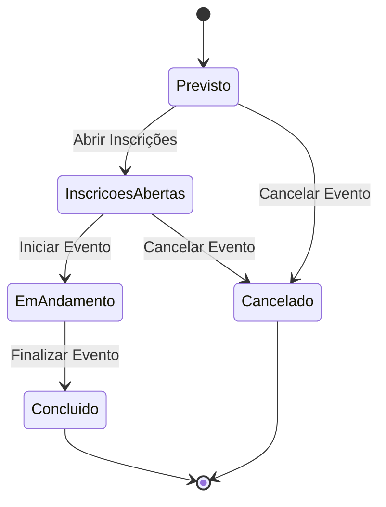

# Catálogo de Regras de Negócio (RN)
## Sistema de Gestão de Eventos Acadêmicos

---

### Histórico de Revisões
| Data | Versão | Descrição | Autor |
| :--- | :--- | :--- | :--- |
| 05/11/2026 | 1.0 | Criação do catálogo dedicado de regras de negócio com detalhamento operacional, validações, exceções e rastreabilidade com RFs. | Engenharia de Software |

---

## 1. Visão Geral e Diretrizes Arquiteturais

As Regras de Negócio (RN) formalizam as políticas, restrições, cálculos e comportamentos invariantes do domínio do **Sistema de Gestão de Eventos Acadêmicos**. 

Conforme os princípios de arquitetura da solução e os pilares da Programação Orientada a Objetos (POO):
1. **Encapsulamento no Domínio:** As validações e regras devem residir prioritariamente nas entidades de negócio (`SistemaGestaoEventosAcademicos.Negocio`) e seus métodos de domínio, e não dispersas na camada de apresentação (Console CLI).
2. **Tratamento de Violações:** Violações de regras de negócio devem gerar exceções de domínio ou retornos estruturados com mensagens descritivas, impedindo a persistência de estados inconsistentes.
3. **Independência Tecnológica:** Nenhuma regra de negócio deve depender de detalhes da camada de apresentação ou de como os dados são persistidos (memória, arquivo JSON ou banco de dados).

---

## 2. Quadro Resumo de Regras de Negócio

| ID | Regra de Negócio | Módulo / Categoria | Severidade | RFs Relacionados |
| :--- | :--- | :--- | :--- | :--- |
| **RN01** | Validação de Cronograma do Evento | Gestão de Eventos | Crítica (Bloqueante) | RF01, RF03 |
| **RN02** | Conflito de Atividades com o Evento | Gestão de Atividades | Crítica (Bloqueante) | RF05, RF07 |
| **RN03** | Limite de Capacidade (Vagas) no Evento | Inscrições e Vagas | Crítica (Bloqueante) | RF11 |
| **RN04** | Unicidade de Inscrição no Evento | Inscrições e Vagas | Crítica (Bloqueante) | RF11 |
| **RN05** | Inscrição em Atividades Dependentes | Inscrições e Vagas | Crítica (Bloqueante) | RF12 |
| **RN06** | Conflito de Horários entre Atividades | Inscrições e Vagas | Alta (Bloqueante) | RF12 |
| **RN07** | Elegibilidade para Certificado | Presença e Certificação | Média (Bloqueante) | RF16 |
| **RN08** | Restrição de Operações em Evento Encerrado | Gestão de Eventos / Inscrições | Crítica (Bloqueante) | RF03, RF04, RF13 |
| **RN09** | Validação e Unicidade de CPF do Participante | Gestão de Participantes | Crítica (Bloqueante) | RF08, RF10 |
| **RN10** | Validação e Unicidade de E-mail | Gestão de Participantes | Alta (Bloqueante) | RF08, RF10 |
| **RN11** | Obrigatoriedade de Dados do Participante | Gestão de Participantes | Alta (Bloqueante) | RF08, RF10 |
| **RN12** | Capacidade e Carga Horária Positivas do Evento | Gestão de Eventos | Alta (Bloqueante) | RF01, RF03 |
| **RN13** | Transições de Status Permitidas do Evento | Gestão de Eventos | Crítica (Bloqueante) | RF04 |
| **RN14** | Período Hábil para Inscrição no Evento | Inscrições e Vagas | Crítica (Bloqueante) | RF11 |
| **RN15** | Capacidade Máxima da Atividade | Gestão de Atividades | Alta (Bloqueante) | RF05, RF07 |
| **RN16** | Unicidade de Inscrição na Atividade | Inscrições e Vagas | Crítica (Bloqueante) | RF12 |
| **RN17** | Limite de Vagas em Atividade Específica | Inscrições e Vagas | Crítica (Bloqueante) | RF12 |
| **RN18** | Conflito de Local/Sala entre Atividades | Gestão de Atividades | Média (Bloqueante) | RF05, RF07 |
| **RN19** | Cancelamento de Inscrição em Cascata | Inscrições e Vagas | Alta (Automática) | RF13 |
| **RN20** | Prazo Limite para Cancelamento de Inscrição | Inscrições e Vagas | Média (Bloqueante) | RF13 |
| **RN21** | Janela de Registro de Presença (Check-in) | Presença e Certificação | Alta (Bloqueante) | RF15 |
| **RN22** | Unicidade de Check-in | Presença e Certificação | Alta (Bloqueante) | RF15 |
| **RN23** | Check-in Exclusivo para Inscrição Ativa | Presença e Certificação | Crítica (Bloqueante) | RF15 |
| **RN24** | Bloqueio de Exclusão de Atividade com Inscritos | Gestão de Atividades | Alta (Bloqueante) | RF07 |
| **RN25** | Carga Horária Certificada Fiel ao Evento | Presença e Certificação | Alta (Consistência) | RF16 |

---

## 3. Detalhamento das Regras de Negócio

### 3.1 Módulo: Gestão de Eventos

#### **RN01 — Validação de Cronograma do Evento**
- **Objetivo:** Impedir inconsistência cronológica na definição do evento.
- **Entidades:** `Evento`
- **Gatilho:** Criação (RF01) ou Edição (RF03) de evento.
- **Validação:**
  1. A `DataFim` deve ser estritamente posterior à `DataInicio` (`DataFim > DataInicio`).
  2. No cadastro de um novo evento, a `DataInicio` não pode ser anterior à data/hora atual do sistema.
- **Violação:** Rejeitar a operação informando: *"A data de término do evento deve ser posterior à data de início e o evento não pode iniciar no passado."*

#### **RN12 — Capacidade e Carga Horária Positivas do Evento**
- **Objetivo:** Assegurar que os dados numéricos de capacidade e certificação sejam válidos.
- **Entidades:** `Evento`
- **Gatilho:** Criação (RF01) ou Edição (RF03) de evento.
- **Validação:**
  1. A `CapacidadeMaxima` deve ser um inteiro maior que zero (`CapacidadeMaxima > 0`).
  2. A `CargaHoraria` (em horas) deve ser um inteiro maior que zero (`CargaHoraria > 0`).
  3. Em caso de edição, a nova `CapacidadeMaxima` não pode ser inferior ao número atual de inscrições ativas já confirmadas para o evento.
- **Violação:** Rejeitar a operação informando: *"A capacidade máxima e a carga horária devem ser maiores que zero. A capacidade não pode ser menor que o total de inscritos atuais."*

#### **RN13 — Transições de Status Permitidas do Evento**
- **Objetivo:** Controlar o ciclo de vida do evento evitando transições incoerentes ou irreversíveis.
- **Entidades:** `Evento`, `StatusEvento`
- **Gatilho:** Alteração de status (RF04).
- **Validação:**
  - `Previsto` pode transitar para: `InscricoesAbertas` ou `Cancelado`.
  - `InscricoesAbertas` pode transitar para: `EmAndamento` ou `Cancelado`.
  - `EmAndamento` pode transitar para: `Concluido`.
  - `Concluido` e `Cancelado` são estados finais (terminais) e não permitem novas transições.
- **Violação:** Rejeitar a operação informando: *"Transição de status inválida de [StatusAtual] para [NovoStatus]."*



#### **RN08 — Restrição de Operações em Evento Encerrado**
- **Objetivo:** Preservar a integridade histórica de eventos finalizados ou anulados.
- **Entidades:** `Evento`, `Inscricao`
- **Gatilho:** Qualquer tentativa de alteração cadastral (RF03, RF04), inclusão de atividades (RF05) ou cancelamento de inscrições (RF13).
- **Validação:** Se o status do evento for `Concluido` ou `Cancelado`, nenhuma alteração cadastral ou de inscrições é permitida.
- **Violação:** Informar: *"O evento está [Concluído/Cancelado]. Operações de alteração não são permitidas."*

---

### 3.2 Módulo: Gestão de Atividades (Palestras, Minicursos, etc.)

#### **RN02 — Conflito de Atividades com o Evento Pai**
- **Objetivo:** Garantir que nenhuma atividade ocorra fora dos limites temporais do evento principal.
- **Entidades:** `Evento`, `Atividade`
- **Gatilho:** Cadastro (RF05) ou Edição (RF07) de atividade.
- **Validação:**
  - `Atividade.DataHoraInicio >= Evento.DataInicio`
  - `Atividade.DataHoraFim <= Evento.DataFim`
  - `Atividade.DataHoraFim > Atividade.DataHoraInicio`
- **Violação:** Rejeitar a operação informando: *"O período da atividade deve estar integralmente compreendido entre o início e o término do evento."*

#### **RN15 — Capacidade Máxima da Atividade**
- **Objetivo:** Evitar que uma sala ou minicurso admita mais participantes que a lotação total do evento.
- **Entidades:** `Atividade`, `Evento`
- **Gatilho:** Cadastro (RF05) ou Edição (RF07) de atividade.
- **Validação:**
  - `Atividade.Vagas > 0`
  - `Atividade.Vagas <= Evento.CapacidadeMaxima`
  - Em edições, `Atividade.Vagas >= total de inscritos atuais na atividade`.
- **Violação:** Rejeitar com mensagem: *"A quantidade de vagas da atividade deve ser maior que zero e não pode exceder a capacidade máxima do evento."*

#### **RN18 — Conflito de Local/Sala entre Atividades Simultâneas**
- **Objetivo:** Evitar sobreposição física de atividades no mesmo espaço do evento.
- **Entidades:** `Atividade`, `Evento`
- **Gatilho:** Cadastro (RF05) ou Edição (RF07) de atividade.
- **Validação:** Duas atividades com o mesmo `Local` (ex.: "Auditório Principal", "Laboratório 02") não podem ter sobreposição de horários dentro do mesmo evento.
  - Sobreposição: `(InicioA < FimB) && (FimA > InicioB)`.
- **Violação:** Informar: *"O local informado já está reservado para outra atividade no mesmo intervalo de horário."*

#### **RN24 — Bloqueio de Exclusão de Atividade com Inscritos**
- **Objetivo:** Manter a consistência das inscrições ativas dos participantes.
- **Entidades:** `Atividade`, `Inscricao`
- **Gatilho:** Remoção de atividade (RF07).
- **Validação:** Uma atividade só pode ser removida se possuir 0 (zero) participantes inscritos.
- **Violação:** Rejeitar a remoção informando: *"Não é possível remover uma atividade que possui participantes inscritos. Cancele as inscrições antes de prosseguir."*

---

### 3.3 Módulo: Gestão de Participantes

#### **RN09 — Validação e Unicidade de CPF do Participante**
- **Objetivo:** Assegurar a identidade individual e idoneidade no cadastro de participantes.
- **Entidades:** `Participante`
- **Gatilho:** Cadastro (RF08) ou Atualização de CPF (RF10).
- **Validação:**
  1. O CPF deve possuir formato numérico válido (11 dígitos, após remoção de pontuação).
  2. Não pode existir mais de um participante com o mesmo CPF cadastrado no sistema.
- **Violação:** Informar: *"CPF inválido ou já cadastrado para outro participante."*

#### **RN10 — Validação e Unicidade de E-mail**
- **Objetivo:** Garantir canal de contato individual e evitar duplicidades de login/identificação.
- **Entidades:** `Participante`
- **Gatilho:** Cadastro (RF08) ou Atualização de E-mail (RF10).
- **Validação:**
  1. O e-mail deve conter formato válido (ex: possuir `@` e domínio válido).
  2. Não pode haver dois participantes com o mesmo e-mail no sistema.
- **Violação:** Informar: *"E-mail em formato inválido ou já cadastrado no sistema."*

#### **RN11 — Obrigatoriedade de Dados do Participante**
- **Objetivo:** Evitar cadastros incompletos ou anônimos.
- **Entidades:** `Participante`
- **Gatilho:** Cadastro (RF08) ou Atualização (RF10).
- **Validação:** Os campos `Nome`, `CPF` e `Email` são de preenchimento estritamente obrigatório (não nulos e não vazios).
- **Violação:** Informar: *"Nome, CPF e E-mail são obrigatórios e devem ser preenchidos."*

---

### 3.4 Módulo: Inscrições e Vagas

#### **RN14 — Período Hábil para Inscrição no Evento**
- **Objetivo:** Impedir inscrições extemporâneas.
- **Entidades:** `Evento`, `Inscricao`
- **Gatilho:** Inscrição em evento (RF11).
- **Validação:** Um participante só pode se inscrever se o evento estiver com `Status == StatusEvento.InscricoesAbertas`. Se o evento estiver `Previsto`, `EmAndamento`, `Concluido` ou `Cancelado`, a inscrição é bloqueada.
- **Violação:** Informar: *"Inscrições indisponíveis. O evento não se encontra com inscrições abertas."*

#### **RN03 — Limite de Capacidade (Vagas) no Evento**
- **Objetivo:** Evitar superlotação e respeitar o dimensionamento do evento.
- **Entidades:** `Evento`, `Inscricao`
- **Gatilho:** Inscrição em evento (RF11).
- **Validação:** Uma inscrição só pode ser aceita se `TotalInscricoesAtivas(Evento) < Evento.CapacidadeMaxima`.
- **Violação:** Informar: *"Inscrição não realizada. Capacidade máxima de vagas esgotada para este evento."*

#### **RN04 — Unicidade de Inscrição no Evento**
- **Objetivo:** Evitar que um mesmo participante ocupe mais de uma vaga no mesmo evento.
- **Entidades:** `Inscricao`, `Participante`, `Evento`
- **Gatilho:** Inscrição em evento (RF11).
- **Validação:** Não pode existir mais de uma inscrição com status ativo para o mesmo par `(ParticipanteId, EventoId)`.
- **Violação:** Informar: *"O participante já possui inscrição ativa neste evento."*

#### **RN05 — Inscrição em Atividades Dependentes**
- **Objetivo:** Garantir a hierarquia de inscrição (evento é o contêiner de atividades).
- **Entidades:** `Inscricao`, `Atividade`, `Evento`
- **Gatilho:** Inscrição em atividade (RF12).
- **Validação:** Para se inscrever em uma atividade de um evento, o participante deve obrigatoriamente possuir inscrição ativa no evento ao qual a atividade pertence.
- **Violação:** Informar: *"Para participar desta atividade, é obrigatório estar inscrito previamente no evento correspondente."*

#### **RN16 — Unicidade de Inscrição na Atividade**
- **Objetivo:** Impedir inscrições duplicadas na mesma atividade.
- **Entidades:** `Inscricao`, `Atividade`
- **Gatilho:** Inscrição em atividade (RF12).
- **Validação:** O participante não pode constar mais de uma vez na lista de inscritos da mesma atividade.
- **Violação:** Informar: *"O participante já está inscrito nesta atividade."*

#### **RN17 — Limite de Vagas em Atividade Específica**
- **Objetivo:** Respeitar a lotação de salas, oficinas e minicursos.
- **Entidades:** `Atividade`, `Inscricao`
- **Gatilho:** Inscrição em atividade (RF12).
- **Validação:** A inscrição só é permitida se o total de inscritos na atividade for menor que `Atividade.Vagas`.
- **Violação:** Informar: *"As vagas para esta atividade estão esgotadas."*

#### **RN06 — Conflito de Horários entre Atividades do Participante**
- **Objetivo:** Impedir que uma pessoa se inscreva em atividades simultâneas, situação fisicamente impossível de comparecimento.
- **Entidades:** `Inscricao`, `Atividade`
- **Gatilho:** Inscrição em atividade (RF12).
- **Validação:** Ao solicitar inscrição na atividade $A$, o sistema deve verificar se o participante já está inscrito em alguma atividade $B$ do mesmo evento onde haja sobreposição de horários:
  $$(Inicio_A < Fim_B) \land (Fim_A > Inicio_B)$$
- **Violação:** Rejeitar a inscrição informando: *"Conflito de horário detectado: você já está inscrito na atividade '[TituloB]' que ocorre no mesmo horário."*

#### **RN19 — Cancelamento de Inscrição em Cascata**
- **Objetivo:** Manter a consistência das vagas ao desvincular um participante de um evento.
- **Entidades:** `Inscricao`, `Atividade`, `Evento`
- **Gatilho:** Cancelamento de inscrição do evento (RF13).
- **Comportamento:** Ao cancelar a inscrição principal do evento, todas as inscrições desse participante nas atividades internas daquele evento são canceladas automaticamente, devolvendo as respectivas vagas para o saldo disponível da atividade e do evento.
- **Pós-condição:** Vagas do evento e das atividades liberadas de forma atômica.

#### **RN20 — Prazo Limite para Cancelamento de Inscrição**
- **Objetivo:** Evitar cancelamentos tardios ou após o início do evento que prejudiquem a organização.
- **Entidades:** `Inscricao`, `Evento`
- **Gatilho:** Cancelamento de inscrição (RF13).
- **Validação:** O cancelamento só é permitido enquanto o evento estiver com status `InscricoesAbertas` e antes da `DataInicio` do evento. Não é permitido cancelar inscrições de eventos `EmAndamento`, `Concluido` ou `Cancelado`.
- **Violação:** Informar: *"Não é permitido cancelar a inscrição após o início ou encerramento do evento."*

---

### 3.5 Módulo: Controle de Presença e Certificação

#### **RN21 — Janela de Registro de Presença (Check-in)**
- **Objetivo:** Impedir registros extemporâneos ou fraudulentos de frequência.
- **Entidades:** `Inscricao`, `Evento`
- **Gatilho:** Registro de presença (RF15).
- **Validação:** O registro de presença só pode ser realizado quando o evento estiver com status `EmAndamento`. Não é permitido check-in em eventos com status `Previsto`, `InscricoesAbertas`, `Cancelado` ou `Concluido`.
- **Violação:** Informar: *"O registro de presença só pode ser efetuado enquanto o evento estiver em andamento."*

#### **RN22 — Unicidade de Check-in (Idempotência)**
- **Objetivo:** Evitar múltiplos registros de presença para a mesma pessoa.
- **Entidades:** `Inscricao`
- **Gatilho:** Registro de presença (RF15).
- **Validação:** Se o participante já teve sua presença confirmada (`PresencaConfirmada == true`), uma nova tentativa de check-in deve informar que a presença já se encontra devidamente registrada.
- **Mensagem:** *"Presença do participante já havia sido confirmada anteriormente."*

#### **RN23 — Check-in Exclusivo para Inscrição Ativa**
- **Objetivo:** Impedir credenciamento de participantes cancelados.
- **Entidades:** `Inscricao`
- **Gatilho:** Registro de presença (RF15).
- **Validação:** Inscrições com status `Cancelada` não podem receber check-in em nenhuma hipótese.
- **Violação:** Informar: *"Não é possível registrar presença para uma inscrição cancelada."*

#### **RN07 — Elegibilidade para Certificado**
- **Objetivo:** Garantir a legitimidade acadêmica dos certificados emitidos.
- **Entidades:** `Inscricao`, `Evento`
- **Gatilho:** Emissão de certificado (RF16).
- **Validação:** Um participante só é elegível a receber certificado se:
  1. O evento estiver com status `Concluido`.
  2. O participante possuir presença confirmada (`PresencaConfirmada == true`).
  3. A inscrição estiver ativa (não cancelada).
- **Violação:** Informar: *"Certificado indisponível. O evento ainda não foi concluído ou a presença não foi registrada."*

#### **RN25 — Carga Horária Certificada Fiel ao Evento**
- **Objetivo:** Padronizar as horas computadas para aproveitamento acadêmico.
- **Entidades:** `Evento`, `Atividade`, `Inscricao`
- **Gatilho:** Emissão de certificado (RF16).
- **Validação:**
  - O certificado de participação geral no evento deve registrar exatamente o valor de `Evento.CargaHoraria`.
  - Se emitido certificado específico por atividade (ex: minicurso), a carga horária deve corresponder à duração calculada da atividade `(DataHoraFim - DataHoraInicio)` ou à carga horária fixada para a atividade.
- **Violação:** Inconsistências de carga horária devem ser bloqueadas no momento da emissão.

---

## 4. Matriz de Rastreabilidade (RF x RN)

> [!NOTE]
> Para a matriz de rastreabilidade completa e multidimensional (incluindo camadas C#, métodos de domínio POO, requisitos não funcionais e cenários de teste), consulte:
> 👉 [matriz-de-rastreabilidade.md](file:///Users/evertoncoimbradearaujo/Documents/GitHub/poo/2026_S2/SistemaGestaoEventosAcademicos/docs/requisitos/matriz-de-rastreabilidade.md).

Esta matriz demonstra como cada Requisito Funcional é governado pelas Regras de Negócio:

| Requisito Funcional (RF) | Regras de Negócio Aplicáveis |
| :--- | :--- |
| **RF01 - Cadastrar Evento** | RN01, RN12 |
| **RF02 - Listar/Consultar Eventos** | RN13 (Filtro por status válidos) |
| **RF03 - Alterar Dados do Evento** | RN01, RN08, RN12 |
| **RF04 - Alterar Status do Evento** | RN08, RN13 |
| **RF05 - Cadastrar Atividade em Evento** | RN02, RN08, RN15, RN18 |
| **RF06 - Listar Atividades do Evento** | RN02, RN15 |
| **RF07 - Remover/Editar Atividade** | RN02, RN08, RN15, RN18, RN24 |
| **RF08 - Cadastrar Participante** | RN09, RN10, RN11 |
| **RF09 - Listar e Buscar Participantes** | RN09, RN10 |
| **RF10 - Atualizar Dados do Participante** | RN09, RN10, RN11 |
| **RF11 - Inscrever Participante no Evento** | RN03, RN04, RN14 |
| **RF12 - Inscrever em Atividade Específica** | RN05, RN06, RN16, RN17 |
| **RF13 - Cancelar Inscrição** | RN08, RN19, RN20 |
| **RF14 - Consultar Minhas Inscrições** | RN04, RN05 |
| **RF15 - Registrar Presença (Check-in)** | RN21, RN22, RN23 |
| **RF16 - Emitir Comprovante / Certificado** | RN07, RN25 |
| **RF17 - Relatório de Participantes por Evento** | RN03, RN04, RN21 |
| **RF18 - Relatório de Ocupação de Vagas** | RN03, RN12, RN15, RN17 |

---

## 5. Diretrizes para Implementação na Camada de Negócio (POO)

1. **Exceções de Domínio Personalizadas:**
   - Criar exceções específicas ou utilizar `InvalidOperationException` e `ArgumentException` com as mensagens padronizadas definidas nas regras.
   - Exemplo didático em `SistemaGestaoEventosAcademicos.Negocio`:
     ```csharp
     public class RegraNegocioException : Exception
     {
         public RegraNegocioException(string mensagem) : base(mensagem) { }
     }
     ```

2. **Métodos Ricos em Vez de Modelos Anêmicos:**
   - Evitar apenas propriedades públicas com `set;` irrestrito.
   - Encapsular as operações em métodos como:
     - `evento.AdicionarAtividade(atividade)` -> valida RN02, RN15, RN18.
     - `evento.AbrirInscricoes()` / `evento.Iniciar()` / `evento.Finalizar()` -> valida RN13.
     - `inscricao.ConfirmarPresenca(statusEvento)` -> valida RN21, RN22, RN23.
     - `inscricao.Cancelar(statusEvento, dataInicioEvento)` -> valida RN08, RN19, RN20.

