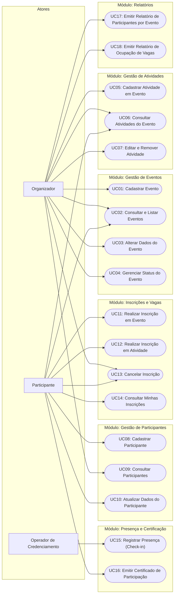

# Especificação de Casos de Uso (ECU)
## Sistema de Gestão de Eventos Acadêmicos

---

### Histórico de Revisões
| Data | Versão | Descrição | Autor |
| :--- | :--- | :--- | :--- |
| 12/11/2026 | 1.0 | Elaboração formal das especificações de casos de uso (UC01 a UC18), diagrama geral e correlação com RFs e RNs. | Engenharia de Software |

---

## 1. Introdução

Este documento apresenta a **Especificação de Casos de Uso (ECU)** do **Sistema de Gestão de Eventos Acadêmicos**. Os casos de uso descrevem detalhadamente o comportamento do sistema a partir da perspectiva dos atores externos, formalizando os fluxos de interação, pré-condições, pós-condições, fluxos alternativos e tratamentos de exceção ancorados nas Regras de Negócio (RN).

O documento atua como ponte direta entre a [Especificação de Requisitos (ERS)](file:///Users/evertoncoimbradearaujo/Documents/GitHub/poo/2026_S2/SistemaGestaoEventosAcademicos/docs/requisitos/01-especificacao-de-requisitos.md), o [Catálogo de Regras de Negócio](file:///Users/evertoncoimbradearaujo/Documents/GitHub/poo/2026_S2/SistemaGestaoEventosAcademicos/docs/requisitos/02-regras-de-negocio.md) e a arquitetura em três camadas da solução C# (`Apresentacao`, `Negocio`, `Persistencia`).

---

## 2. Atores do Sistema

| Ator | Descrição |
| :--- | :--- |
| **Organizador** | Usuário administrativo responsável pela criação, parametrização, gestão de status de eventos, cadastro de atividades e extração de relatórios operacionais. |
| **Participante** | Aluno, docente ou membro da comunidade que consulta eventos, realiza inscrições, inscreve-se em atividades específicas, consulta seu histórico e emite certificados. |
| **Operador de Credenciamento** | Responsável por validar e registrar a presença dos participantes no local ou sessão do evento (check-in). |

---

## 3. Diagrama Geral de Casos de Uso

---

## 4. Matriz Resumo dos Casos de Uso

| Caso de Uso | Nome | Ator Principal | RF Vinculado | Regras de Negócio | Prioridade (MoSCoW) |
| :--- | :--- | :--- | :--- | :--- | :---: |
| **UC01** | Cadastrar Evento | Organizador | RF01 | RN01, RN12 | **Must Have** |
| **UC02** | Consultar e Listar Eventos | Organizador / Participante | RF02 | RN13 | **Must Have** |
| **UC03** | Alterar Dados do Evento | Organizador | RF03 | RN01, RN08, RN12 | **Must Have** |
| **UC04** | Gerenciar Status do Evento | Organizador | RF04 | RN08, RN13 | **Must Have** |
| **UC05** | Cadastrar Atividade em Evento | Organizador | RF05 | RN02, RN08, RN15, RN18 | **Must Have** |
| **UC06** | Consultar Atividades do Evento | Organizador / Participante | RF06 | RN02, RN15 | **Must Have** |
| **UC07** | Editar e Remover Atividade | Organizador | RF07 | RN02, RN08, RN15, RN18, RN24 | **Should Have** |
| **UC08** | Cadastrar Participante | Participante / Organizador | RF08 | RN09, RN10, RN11 | **Must Have** |
| **UC09** | Consultar Participantes | Organizador | RF09 | RN09, RN10 | **Must Have** |
| **UC10** | Atualizar Dados do Participante | Participante / Organizador | RF10 | RN09, RN10, RN11 | **Should Have** |
| **UC11** | Realizar Inscrição em Evento | Participante | RF11 | RN03, RN04, RN14 | **Must Have** |
| **UC12** | Realizar Inscrição em Atividade | Participante | RF12 | RN05, RN06, RN16, RN17 | **Should Have** |
| **UC13** | Cancelar Inscrição | Participante / Organizador | RF13 | RN08, RN19, RN20 | **Must Have** |
| **UC14** | Consultar Minhas Inscrições | Participante | RF14 | RN04, RN05 | **Should Have** |
| **UC15** | Registrar Presença (Check-in) | Operador de Credenciamento | RF15 | RN21, RN22, RN23 | **Must Have** |
| **UC16** | Emitir Certificado de Participação | Participante / Organizador | RF16 | RN07, RN25 | **Should Have** |
| **UC17** | Emitir Relatório de Participantes por Evento | Organizador | RF17 | RN03, RN04, RN21 | **Must Have** |
| **UC18** | Emitir Relatório de Ocupação de Vagas | Organizador | RF18 | RN03, RN12, RN15, RN17 | **Should Have** |

---

## 5. Especificação Detalhada dos Casos de Uso

---

### UC01 — Cadastrar Evento
* **Ator Principal:** Organizador
* **Requisito Funcional:** RF01
* **Regras de Negócio:** RN01, RN12
* **Pré-condições:** O Organizador deve estar autenticado no terminal e no menu de gestão de eventos.
* **Pós-condições:** Um novo objeto `Evento` é instanciado no domínio com status inicial `Previsto` e persistido no repositório.
* **Fluxo Principal:**
  1. O Organizador seleciona a opção "Cadastrar Evento".
  2. O sistema solicita os dados obrigatórios: Nome/Título, Descrição, Data/Hora de Início, Data/Hora de Término, Local, Carga Horária e Capacidade Máxima.
  3. O Organizador informa os dados requisitados.
  4. O sistema valida os valores na camada de domínio:
     - `DataFim > DataInicio` e `DataInicio >= DataAtual` (RN01).
     - `CapacidadeMaxima > 0` e `CargaHoraria > 0` (RN12).
  5. O sistema persiste o evento com status `Previsto`.
  6. O sistema exibe mensagem de sucesso com o ID do evento cadastrado.
* **Fluxos de Exceção:**
  - **4a. Cronograma Inválido (RN01):** Se a data de fim for anterior/igual à data de início, ou se a data de início estiver no passado, o sistema emite mensagem de erro e aborta a criação sem persistir o evento.
  - **4b. Parâmetros Numéricos Inválidos (RN12):** Se a capacidade máxima ou a carga horária for menor ou igual a zero, o sistema notifica a inconsistência e solicita nova entrada.

---

### UC02 — Consultar e Listar Eventos
* **Ator Principal:** Organizador / Participante
* **Requisito Funcional:** RF02
* **Regras de Negócio:** RN13
* **Pré-condições:** Nenhuma.
* **Pós-condições:** Os dados cadastrais dos eventos são exibidos na tela sem alterações de estado.
* **Fluxo Principal:**
  1. O usuário seleciona "Listar Eventos".
  2. O sistema recupera a coleção de eventos do repositório.
  3. O sistema exibe uma listagem sumarizada (ID, Nome, Datas, Capacidade, Vagas Restantes e Status Atual).
  4. O usuário pode informar o ID de um evento específico para exibir todos os detalhes e atividades vinculadas.
* **Fluxos Alternativos:**
  - **3a. Filtrar por Status:** O usuário opta por visualizar somente eventos em determinado estado (ex.: `InscricoesAbertas`). O sistema aplica o filtro sobre a coleção e exibe o subconjunto.
  - **3b. Nenhum Evento Cadastrado:** Se a base estiver vazia, o sistema exibe a mensagem amigável: "Nenhum evento cadastrado até o momento".

---

### UC03 — Alterar Dados do Evento
* **Ator Principal:** Organizador
* **Requisito Funcional:** RF03
* **Regras de Negócio:** RN01, RN08, RN12
* **Pré-condições:** O evento a ser alterado deve existir previamente.
* **Pós-condições:** As informações cadastrais do evento são atualizadas na base de dados.
* **Fluxo Principal:**
  1. O Organizador seleciona "Editar Evento" e informa o ID do evento.
  2. O sistema busca o evento e verifica seu status atual.
  3. O sistema valida que o evento NÃO está nos status `Concluido` ou `Cancelado` (RN08).
  4. O sistema apresenta os dados atuais e solicita os novos valores (Nome, Descrição, Datas, Local, Capacidade e Carga Horária).
  5. O Organizador informa as novas informações.
  6. O sistema valida as novas datas (RN01) e a nova capacidade (RN12).
  7. O evento é atualizado no repositório.
  8. O sistema exibe mensagem de confirmação da atualização.
* **Fluxos de Exceção:**
  - **3a. Evento em Estado Terminal (RN08):** Se o evento estiver `Concluido` ou `Cancelado`, o sistema emite exceção de domínio impedindo qualquer modificação cadastral.
  - **6a. Redução Inválida de Capacidade (RN12):** Se a nova capacidade for inferior à contagem de participantes já inscritos ativamente, a operação é bloqueada.

---

### UC04 — Gerenciar Status do Evento
* **Ator Principal:** Organizador
* **Requisito Funcional:** RF04
* **Regras de Negócio:** RN08, RN13
* **Pré-condições:** Evento existente.
* **Pós-condições:** Status do evento é transicionado de acordo com a máquina de estados.
* **Fluxo Principal:**
  1. O Organizador solicita "Alterar Status do Evento" informando o ID.
  2. O sistema exibe o status atual e as transições possíveis.
  3. O Organizador escolhe o novo status desejado.
  4. O sistema valida se a transição é permitida pelas regras da máquina de estados (RN13):
     - `Previsto` $\rightarrow$ `InscricoesAbertas` ou `Cancelado`
     - `InscricoesAbertas` $\rightarrow$ `EmAndamento` ou `Cancelado`
     - `EmAndamento` $\rightarrow$ `Concluido` ou `Cancelado`
  5. O sistema atualiza o status do evento no repositório.
  6. O sistema emite mensagem de sucesso.
* **Fluxos de Exceção:**
  - **4a. Transição Ilegal (RN13):** Tentativa de pular estados obrigatórios (ex.: de `Previsto` direto para `Concluido`) é rejeitada com mensagem descritiva da regra violada.
  - **4b. Alteração em Estado Final (RN08):** Se o evento já for `Concluido` ou `Cancelado`, o sistema impede reabertura ou qualquer alteração posterior.

---

### UC05 — Cadastrar Atividade em Evento
* **Ator Principal:** Organizador
* **Requisito Funcional:** RF05
* **Regras de Negócio:** RN02, RN08, RN15, RN18
* **Pré-condições:** Evento pai existente e modificável (`Previsto` ou `InscricoesAbertas`).
* **Pós-condições:** Nova instância de `Atividade` é associada por composição à coleção de atividades do `Evento`.
* **Fluxo Principal:**
  1. O Organizador escolhe a opção "Adicionar Atividade ao Evento" e informa o ID do evento pai.
  2. O sistema valida se o evento permite alterações estruturais (RN08).
  3. O sistema solicita: Título, Tipo (Palestra, Minicurso, Oficina, etc.), Responsável, Horário de Início, Horário de Término, Local/Sala e Vagas da atividade.
  4. O Organizador fornece os dados.
  5. O sistema realiza as validações de domínio:
     - Horários da atividade devem estar contidos no intervalo do evento pai (RN02).
     - Capacidade da atividade $> 0$ e $\le$ capacidade do evento (RN15).
     - Ausência de conflito de local/sala com outra atividade existente no mesmo horário (RN18).
  6. A atividade é anexada ao evento e o repositório é atualizado.
  7. O sistema confirma o cadastro da atividade.
* **Fluxos de Exceção:**
  - **5a. Atividade Fora do Horário do Evento (RN02):** Sistema recusa o cadastro caso o horário extrapole o início ou término do evento pai.
  - **5b. Lotação Superior ao Evento (RN15):** Sistema bloqueia capacidade de atividade que exceda o teto global do evento.
  - **5c. Choque de Sala (RN18):** Sistema notifica que o local já está alocado para outra atividade naquele período.

---

### UC06 — Consultar Atividades do Evento
* **Ator Principal:** Organizador / Participante
* **Requisito Funcional:** RF06
* **Regras de Negócio:** RN02, RN15
* **Pré-condições:** Evento informado existente.
* **Pós-condições:** Lista das atividades do evento exibida em tela.
* **Fluxo Principal:**
  1. O usuário seleciona "Listar Atividades de um Evento" e informa o ID do evento.
  2. O sistema recupera as atividades associadas ao evento.
  3. O sistema exibe para cada atividade: Título, Tipo, Responsável, Horário, Local, Vagas Totais e Vagas Livres.

---

### UC07 — Editar e Remover Atividade
* **Ator Principal:** Organizador
* **Requisito Funcional:** RF07
* **Regras de Negócio:** RN02, RN08, RN15, RN18, RN24
* **Pré-condições:** Atividade e evento existentes.
* **Pós-condições:** Atividade atualizada ou removida da coleção do evento.
* **Fluxo Principal (Remoção):**
  1. O Organizador solicita a exclusão de uma atividade.
  2. O sistema verifica se existem participantes inscritos ativamente na atividade (RN24).
  3. O sistema valida se o evento está em estado modificável (RN08).
  4. O sistema remove a atividade do evento e persiste a alteração.
* **Fluxos de Exceção:**
  - **2a. Atividade com Participantes Inscritos (RN24):** A exclusão é estritamente bloqueada para resguardar a integridade das inscrições dos participantes.

---

### UC08 — Cadastrar Participante
* **Ator Principal:** Participante / Organizador
* **Requisito Funcional:** RF08
* **Regras de Negócio:** RN09, RN10, RN11
* **Pré-condições:** Nenhuma.
* **Pós-condições:** Participante cadastrado e habilitado a realizar inscrições em eventos.
* **Fluxo Principal:**
  1. O usuário seleciona "Cadastrar Participante".
  2. O sistema solicita: Nome Completo, CPF, E-mail e Instituição/Curso.
  3. O usuário fornece as informações.
  4. O sistema valida os dados de entrada:
     - Campos obrigatórios não vazios (RN11).
     - Formato de CPF e unicidade na base (RN09).
     - Formato de E-mail e unicidade na base (RN10).
  5. O participante é registrado no repositório de participantes.
  6. O sistema exibe confirmação de sucesso com identificador do participante.
* **Fluxos de Exceção:**
  - **4a. CPF Duplicado ou Inválido (RN09):** O sistema impede o cadastro e alerta que o documento informado é inválido ou já se encontra registrado.
  - **4b. E-mail Duplicado ou Inválido (RN10):** Cadastro recusado por conflito de e-mail.

---

### UC09 — Consultar Participantes
* **Ator Principal:** Organizador
* **Requisito Funcional:** RF09
* **Regras de Negócio:** RN09, RN10
* **Pré-condições:** Nenhuma.
* **Pós-condições:** Dados dos participantes exibidos na tela.
* **Fluxo Principal:**
  1. O Organizador escolhe "Consultar Participantes".
  2. O sistema oferece opções: Listar Todos ou Buscar por CPF/Nome.
  3. O Organizador fornece o critério de busca.
  4. O sistema retorna a lista de participantes correspondentes.

---

### UC10 — Atualizar Dados do Participante
* **Ator Principal:** Participante / Organizador
* **Requisito Funcional:** RF10
* **Regras de Negócio:** RN09, RN10, RN11
* **Pré-condições:** Participante previamente cadastrado.
* **Pós-condições:** Cadastro do participante atualizado.
* **Fluxo Principal:**
  1. O usuário seleciona "Editar Cadastro de Participante" e informa seu CPF.
  2. O sistema localiza o registro e permite editar Nome, E-mail e Instituição.
  3. O sistema valida o novo e-mail (RN10) e a completude dos dados (RN11).
  4. As alterações são persistidas no repositório.

---

### UC11 — Realizar Inscrição em Evento
* **Ator Principal:** Participante
* **Requisito Funcional:** RF11
* **Regras de Negócio:** RN03, RN04, RN14
* **Pré-condições:** Participante cadastrado e evento existente.
* **Pós-condições:** Nova `Inscricao` ativa gerada e número de vagas livres do evento decrementado.
* **Fluxo Principal:**
  1. O Participante escolhe a opção "Inscrever-se em Evento".
  2. O sistema solicita a identificação do participante (CPF) e o ID do evento desejado.
  3. O sistema valida as condições de negócio:
     - O evento está com status `InscricoesAbertas` (RN14).
     - O evento possui vagas disponíveis (`TotalInscritos < CapacidadeMaxima`) (RN03).
     - O participante ainda não possui inscrição ativa no evento (RN04).
  4. O sistema cria o registro de `Inscricao` com status `Ativa` e data/hora do registro.
  5. O repositório armazena a inscrição.
  6. O sistema emite mensagem de confirmação e exibe o número de protocolo da inscrição.
* **Fluxos de Exceção:**
  - **3a. Inscrições Não Abertas (RN14):** Inscrição bloqueada se evento estiver em `Previsto`, `EmAndamento`, `Concluido` ou `Cancelado`.
  - **3b. Vagas Esgotadas (RN03):** Se a capacidade estiver atingida, o sistema recusa a operação informando lotação esgotada.
  - **3c. Inscrição Duplicada (RN04):** O sistema impede nova inscrição para o mesmo participante no mesmo evento.

---

### UC12 — Realizar Inscrição em Atividade
* **Ator Principal:** Participante
* **Requisito Funcional:** RF12
* **Regras de Negócio:** RN05, RN06, RN16, RN17
* **Pré-condições:** Participante com inscrição ATIVA no evento pai correspondente.
* **Pós-condições:** Atividade associada à inscrição do participante e vaga da atividade consumida.
* **Fluxo Principal:**
  1. O Participante solicita "Inscrever em Atividade de Evento".
  2. O sistema requisita o número da inscrição no evento e o identificador da atividade.
  3. O sistema verifica as regras de domínio:
     - Participante possui inscrição ativa no evento ao qual a atividade pertence (RN05).
     - Participante ainda não está inscrito nesta atividade (RN16).
     - A atividade possui vagas disponíveis (RN17).
     - Não há sobreposição de horário com outra atividade já inscrita pelo participante (RN06).
  4. O sistema vincula a atividade à inscrição do participante.
  5. O sistema confirma a inscrição na atividade com sucesso.
* **Fluxos de Exceção:**
  - **3a. Sem Inscrição no Evento Pai (RN05):** Bloqueio imediato caso o participante tente se inscrever direto na atividade sem pertencer ao evento.
  - **3b. Conflito de Horário (RN06):** Bloqueio caso a atividade concorra no mesmo intervalo de horário de outra atividade previamente agendada.
  - **3c. Vagas da Atividade Esgotadas (RN17):** Inscrição rejeitada por lotação da atividade.

---

### UC13 — Cancelar Inscrição
* **Ator Principal:** Participante / Organizador
* **Requisito Funcional:** RF13
* **Regras de Negócio:** RN08, RN19, RN20
* **Pré-condições:** Inscrição existente com status `Ativa`.
* **Pós-condições:** Inscrição marcada como `Cancelada`, com desocupação de vaga no evento e em todas as atividades vinculadas.
* **Fluxo Principal:**
  1. O usuário escolhe "Cancelar Inscrição" e informa o ID da inscrição.
  2. O sistema recupera a inscrição e o evento associado.
  3. O sistema avalia as regras de negócio:
     - O evento não está cancelado ou encerrado (RN08).
     - A data e hora atual é anterior à `DataInicio` do evento (RN20).
  4. O sistema altera o status da inscrição para `Cancelada`.
  5. O sistema desvincula o participante das atividades vinculadas liberando as vagas correspondentes em cascata (RN19).
  6. O repositório persiste as alterações.
  7. O sistema confirma o cancelamento e a liberação das vagas.
* **Fluxos de Exceção:**
  - **3a. Prazo Limite Expirado (RN20):** Cancelamento bloqueado caso o evento já tenha iniciado.

---

### UC14 — Consultar Minhas Inscrições
* **Ator Principal:** Participante
* **Requisito Funcional:** RF14
* **Regras de Negócio:** RN04, RN05
* **Pré-condições:** Participante cadastrado.
* **Pós-condições:** Lista das inscrições do participante exibida.
* **Fluxo Principal:**
  1. O Participante informa seu CPF.
  2. O sistema recupera todas as inscrições registradas para aquele CPF.
  3. O sistema exibe os eventos, status das inscrições, atividades selecionadas e se a presença foi confirmada.

---

### UC15 — Registrar Presença (Check-in)
* **Ator Principal:** Operador de Credenciamento
* **Requisito Funcional:** RF15
* **Regras de Negócio:** RN21, RN22, RN23
* **Pré-condições:** Evento com status `EmAndamento`.
* **Pós-condições:** Propriedade de presença da inscrição marcada como confirmada.
* **Fluxo Principal:**
  1. O Operador acessa o menu de credenciamento e informa o ID do evento e o CPF do participante.
  2. O sistema localiza a inscrição do participante no evento.
  3. O sistema valida as diretrizes de credenciamento:
     - O evento deve estar com status `EmAndamento` (RN21).
     - A inscrição do participante deve estar `Ativa` (RN23).
  4. O sistema verifica se a presença já havia sido confirmada anteriormente (RN22):
     - Caso não confirmada, atualiza o status de presença para verdadeiro e registra o timestamp do check-in.
  5. O sistema exibe mensagem de boas-vindas e confirmação de presença do participante.
* **Fluxos Alternativos:**
  - **4a. Presença Já Confirmada (Idempotência - RN22):** O sistema informa: "Aviso: Presença deste participante já foi confirmada anteriormente", sem corromper ou duplicar o registro.
* **Fluxos de Exceção:**
  - **3a. Evento Fora do Horário / Não Iniciado (RN21):** O sistema rejeita o check-in caso o evento ainda esteja em `Previsto`, `InscricoesAbertas` ou já tenha sido `Concluido`.
  - **3b. Inscrição Cancelada (RN23):** Bloqueio estrito informando que participantes com inscrição cancelada não podem fazer credenciamento.

---

### UC16 — Emitir Certificado de Participação
* **Ator Principal:** Participante / Organizador
* **Requisito Funcional:** RF16
* **Regras de Negócio:** RN07, RN25
* **Pré-condições:** Inscrição ativa existente.
* **Pós-condições:** Resumo de certificação emitido na tela ou arquivo.
* **Fluxo Principal:**
  1. O usuário solicita a emissão de certificado informando o código da inscrição.
  2. O sistema verifica os critérios de elegibilidade:
     - O evento associado deve estar com status `Concluido` (RN07).
     - O participante deve possuir confirmação de presença (`Check-in = true`) (RN07).
  3. O sistema recupera os dados do evento, participante e carga horária oficial cadastrada (RN25).
  4. O sistema gera a declaração formatada de certificado contendo: Nome do Participante, CPF, Título do Evento, Carga Horária Cumprida e Data de Conclusão.
  5. O certificado é exibido em tela.
* **Fluxos de Exceção:**
  - **2a. Inelegibilidade por Ausência ou Evento Não Concluído (RN07):** O sistema bloqueia a emissão informando o motivo (evento ainda em andamento ou falta de check-in confirmado).

---

### UC17 — Emitir Relatório de Participantes por Evento
* **Ator Principal:** Organizador
* **Requisito Funcional:** RF17
* **Regras de Negócio:** RN03, RN04, RN21
* **Pré-condições:** Evento existente.
* **Pós-condições:** Relatório administrativo impresso no console.
* **Fluxo Principal:**
  1. O Organizador seleciona "Relatório de Inscritos por Evento" e digita o ID do evento.
  2. O sistema recupera a lista de inscrições ativas e canceladas daquele evento.
  3. O sistema cruza as informações com o cadastro de participantes.
  4. O sistema exibe a listagem contendo: Nome, CPF, E-mail, Status da Inscrição e Situação de Presença (Check-in Realizado / Pendente).
  5. O sistema exibe o totalizador de inscritos confirmados versus presentes.

---

### UC18 — Emitir Relatório de Ocupação de Vagas
* **Ator Principal:** Organizador
* **Requisito Funcional:** RF18
* **Regras de Negócio:** RN03, RN12, RN15, RN17
* **Pré-condições:** Pelo menos um evento cadastrado.
* **Pós-condições:** Painel de taxas de ocupação exibido no terminal.
* **Fluxo Principal:**
  1. O Organizador escolhe "Relatório de Ocupação de Vagas".
  2. O sistema percorre todos os eventos cadastrados.
  3. Para cada evento, o sistema calcula: Capacidade Total, Inscrições Ativas, Vagas Livres e Percentual de Ocupação (%).
  4. Para cada atividade do evento, calcula analogamente a taxa de preenchimento de suas respectivas salas/vagas.
  5. O sistema imprime os dados de forma tabulada no console.

