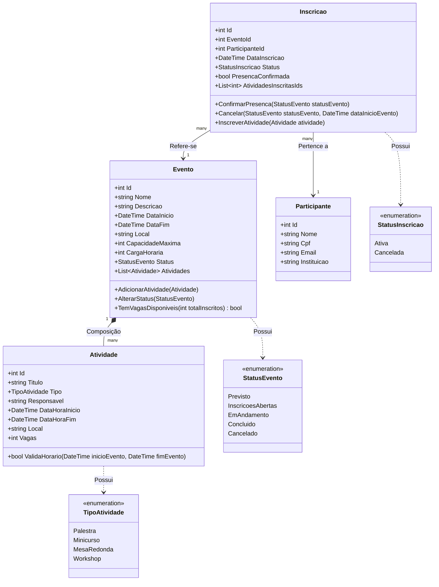

# Especificação de Requisitos de Software (ERS)
## Sistema de Gestão de Eventos Acadêmicos

---

### Histórico de Revisões
| Data | Versão | Descrição | Autor |
| :--- | :--- | :--- | :--- |
| 05/11/2026 | 1.0 | Elaboração inicial dos requisitos funcionais, não funcionais e regras de negócio. | Engenharia de Software |
| 05/11/2026 | 1.1 | Expansão das regras de negócio (RN01 a RN25), alinhamento com diagrama de estados e vínculo com catálogo dedicado em `regras-de-negocio.md`. | Engenharia de Software |

---

## 1. Introdução

### 1.1 Objetivo
Este documento define a especificação formal de requisitos para o desenvolvimento do **Sistema de Gestão de Eventos Acadêmicos**. O objetivo do software é permitir a organização, administração, controle de inscrições, alocação de atividades e registro de frequência em eventos de natureza acadêmica (como semanas acadêmicas, simpósios, congressos, palestras e minicursos).

### 1.2 Contexto e Alinhamento Arquitetural
Conforme delineado na diretriz de arquitetura da solução (`docs/01-primeiros-passos-e-camadas.md`), o sistema é construído em C# (.NET) e estruturado rigorosamente em três camadas independentes:
- **Apresentação (`SistemaGestaoEventosAcademicos.Apresentacao`):** Camada de console (CLI) responsável pela interação com o usuário, exibição de menus e captura de dados.
- **Negócio (`SistemaGestaoEventosAcademicos.Negocio`):** Núcleo da aplicação contendo as entidades de domínio, regras de negócio, validações e comportamentos orientados a objetos.
- **Persistência (`SistemaGestaoEventosAcademicos.Persistencia`):** Camada responsável pela retenção e recuperação das entidades (em memória e/ou arquivos).

---

## 2. Perfis de Usuários (Atores)

| Ator | Descrição |
| :--- | :--- |
| **Organizador / Administrador** | Responsável pelo ciclo de vida do evento: criação, configuração de datas, cadastro de atividades/minicursos, encerramento de evento e consulta de relatórios de inscritos. |
| **Participante (Aluno / Docente / Externo)** | Pessoa que consulta o catálogo de eventos disponíveis, realiza inscrição em eventos e atividades, e acompanha sua participação. |
| **Operador de Credenciamento** | Responsável por registrar a presença dos participantes no dia do evento (check-in). |

---

## 3. Requisitos Funcionais (RF)

Os requisitos funcionais estão priorizados conforme a metodologia **MoSCoW**:
- **Must Have:** Essencial para que o sistema funcione como um MVP (Produto Mínimo Viável).
- **Should Have:** Importante, devendo ser incluído logo após o núcleo básico.
- **Could Have:** Desejável se houver disponibilidade de tempo.

### 3.1 Módulo: Gestão de Eventos

| ID | Requisito Funcional | Descrição | Prioridade |
| :--- | :--- | :--- | :--- |
| **RF01** | **Cadastrar Evento** | O sistema deve permitir ao Organizador cadastrar um novo evento contendo: Identificador único, Nome/Título, Descrição, Data e Hora de Início, Data e Hora de Término, Local (físico ou link virtual), Carga Horária Total e Capacidade Máxima de Participantes. | **Must Have** |
| **RF02** | **Listar/Consultar Eventos** | O sistema deve disponibilizar a listagem de todos os eventos cadastrados, permitindo visualizar detalhes de um evento específico e filtrar por status (Previsto, Aberto para Inscrições, Em Andamento, Concluído, Cancelado). | **Must Have** |
| **RF03** | **Alterar Dados do Evento** | O sistema deve permitir atualizar informações cadastrais de eventos que ainda não foram concluídos ou cancelados. | **Must Have** |
| **RF04** | **Alterar Status do Evento** | O sistema deve permitir alterar o estado de um evento (ex: abrir inscrições, iniciar evento, finalizar evento ou cancelar evento). | **Must Have** |

### 3.2 Módulo: Gestão de Atividades do Evento (Palestras, Minicursos, etc.)

| ID | Requisito Funcional | Descrição | Prioridade |
| :--- | :--- | :--- | :--- |
| **RF05** | **Cadastrar Atividade em Evento** | O sistema deve permitir associar uma ou mais atividades a um evento existente. A atividade deve conter: Identificador, Título, Tipo (Palestra, Minicurso, Mesa Redonda, Workshop), Responsável/Palestrante, Horário de Início, Horário de Fim, Local e Limite de Vagas específico. | **Must Have** |
| **RF06** | **Listar Atividades do Evento** | O sistema deve permitir listar todas as atividades vinculadas a determinado evento com suas respectivas vagas disponíveis. | **Must Have** |
| **RF07** | **Remover/Editar Atividade** | O sistema deve permitir editar ou remover uma atividade do evento, desde que não infrinja integridade com inscrições ativas. | **Should Have** |

### 3.3 Módulo: Gestão de Participantes

| ID | Requisito Funcional | Descrição | Prioridade |
| :--- | :--- | :--- | :--- |
| **RF08** | **Cadastrar Participante** | O sistema deve permitir o cadastro de participantes com: Identificador, Nome Completo, CPF/Documento de Identificação, E-mail institucional/pessoal e Instituição/Curso de origem. | **Must Have** |
| **RF09** | **Listar e Buscar Participantes** | O sistema deve permitir listar todos os participantes e buscar por CPF, e-mail ou nome. | **Must Have** |
| **RF10** | **Atualizar Dados do Participante** | O sistema deve permitir atualizar os dados cadastrais (ex.: e-mail, instituição) de um participante. | **Should Have** |

### 3.4 Módulo: Inscrições e Vagas

| ID | Requisito Funcional | Descrição | Prioridade |
| :--- | :--- | :--- | :--- |
| **RF11** | **Inscrever Participante no Evento** | O sistema deve registrar a inscrição de um participante em um evento com inscrições abertas, decrementando as vagas disponíveis do evento. | **Must Have** |
| **RF12** | **Inscrever em Atividade Específica** | O sistema deve permitir ao participante já inscrito no evento realizar inscrição nas atividades específicas (minicursos, oficinas) associadas ao evento, respeitando a lotação da sala/atividade. | **Should Have** |
| **RF13** | **Cancelar Inscrição** | O sistema deve permitir o cancelamento da inscrição por solicitação do participante ou organizador, liberando a respectiva vaga. | **Must Have** |
| **RF14** | **Consultar Minhas Inscrições** | O sistema deve permitir consultar todas as inscrições ativas de um determinado participante e os eventos/atividades nos quais ele está alocado. | **Should Have** |

### 3.5 Módulo: Controle de Presença e Certificação

| ID | Requisito Funcional | Descrição | Prioridade |
| :--- | :--- | :--- | :--- |
| **RF15** | **Registrar Presença (Check-in)** | O sistema deve permitir registrar a presença do participante no evento e/ou em suas atividades individuais. | **Must Have** |
| **RF16** | **Emitir Comprovante / Certificado** | O sistema deve gerar um registro ou resumo textual de certificação contendo o nome do participante, evento, carga horária e confirmação de presença para os participantes elegíveis. | **Should Have** |

### 3.6 Módulo: Relatórios Administrativos

| ID | Requisito Funcional | Descrição | Prioridade |
| :--- | :--- | :--- | :--- |
| **RF17** | **Relatório de Participantes por Evento** | O sistema deve exibir a lista completa de inscritos de um evento, informando status de inscrição e confirmação de presença. | **Must Have** |
| **RF18** | **Relatório de Ocupação de Vagas** | O sistema deve exibir um resumo da taxa de ocupação (total de vagas, vagas preenchidas e vagas restantes) para cada evento e atividade. | **Should Have** |

---

## 4. Regras de Negócio (RN)

As regras de negócio expressam as restrições que devem ser validadas e garantidas na camada de **Negócio** (`SistemaGestaoEventosAcademicos.Negocio`).

> [!NOTE]
> Para o catálogo exaustivo com condições de disparo, pré e pós-condições, mensagens de exceção padronizadas e matriz de rastreabilidade completa, consulte o documento específico:
> 👉 [regras-de-negocio.md](file:///Users/evertoncoimbradearaujo/Documents/GitHub/poo/2026_S2/SistemaGestaoEventosAcademicos/docs/requisitos/regras-de-negocio.md).

### 4.1 Resumo das Regras de Negócio do Sistema

| ID | Regra de Negócio | Módulo | Descrição Sucinta |
| :--- | :--- | :--- | :--- |
| **RN01** | **Validação de Cronograma do Evento** | Eventos | `DataFim > DataInicio`. Eventos novos não podem iniciar no passado. |
| **RN02** | **Conflito de Atividades com o Evento** | Atividades | Horários da atividade devem estar estritamente contidos no período do evento pai. |
| **RN03** | **Limite de Capacidade (Vagas) no Evento** | Inscrições | Inscrição recusada se total de inscritos ativos atingir a `CapacidadeMaxima`. |
| **RN04** | **Unicidade de Inscrição no Evento** | Inscrições | Participante só pode ter uma inscrição ativa por evento. |
| **RN05** | **Inscrição em Atividades Dependentes** | Inscrições | Inscrição em atividade exige inscrição ativa prévia no evento pai. |
| **RN06** | **Conflito de Horários entre Atividades** | Inscrições | Participante não pode se inscrever em duas atividades com horários sobrepostos. |
| **RN07** | **Elegibilidade para Certificado** | Certificação | Presença confirmada (`Check-in`) e evento com status `Concluido`. |
| **RN08** | **Restrição de Operações em Evento Encerrado** | Eventos | Bloqueia alterações em eventos com status `Concluido` ou `Cancelado`. |
| **RN09** | **Validação e Unicidade de CPF** | Participantes | CPF obrigatório, numérico válido (11 dígitos) e único no sistema. |
| **RN10** | **Validação e Unicidade de E-mail** | Participantes | E-mail com formato válido e sem duplicidade na base de participantes. |
| **RN11** | **Obrigatoriedade de Dados do Participante** | Participantes | Nome, CPF e E-mail não podem ser nulos nem em branco. |
| **RN12** | **Capacidade e Carga Horária Positivas** | Eventos | `CapacidadeMaxima > 0`, `CargaHoraria > 0`. Capacidade não pode ser reduzida abaixo dos inscritos atuais. |
| **RN13** | **Transições de Status Permitidas** | Eventos | Fluxo restrito: `Previsto` -> `InscricoesAbertas` -> `EmAndamento` -> `Concluido` (ou `Cancelado`). |
| **RN14** | **Período Hábil para Inscrição** | Inscrições | Novas inscrições só são permitidas enquanto status for `InscricoesAbertas`. |
| **RN15** | **Capacidade Máxima da Atividade** | Atividades | `Vagas > 0` e menor ou igual à capacidade máxima do evento pai. |
| **RN16** | **Unicidade de Inscrição na Atividade** | Inscrições | Participante não pode se inscrever mais de uma vez na mesma atividade. |
| **RN17** | **Limite de Vagas em Atividade Específica** | Inscrições | Inscrição bloqueada quando atingir a lotação máxima da sala/atividade. |
| **RN18** | **Conflito de Local/Sala entre Atividades** | Atividades | Não permitir duas atividades simultâneas no mesmo espaço físico/sala. |
| **RN19** | **Cancelamento de Inscrição em Cascata** | Inscrições | Cancelar inscrição do evento cancela e libera vagas de todas as atividades associadas. |
| **RN20** | **Prazo Limite para Cancelamento** | Inscrições | Cancelamento permitido apenas antes do início do evento (`DataInicio`). |
| **RN21** | **Janela de Registro de Presença (Check-in)** | Presença | Check-in permitido exclusivamente enquanto o evento estiver `EmAndamento`. |
| **RN22** | **Unicidade de Check-in** | Presença | Check-in é idempotente; registrar presença mais de uma vez não duplica o registro. |
| **RN23** | **Check-in Exclusivo para Inscrição Ativa** | Presença | Proibido registrar presença para inscrições canceladas. |
| **RN24** | **Bloqueio de Exclusão de Atividade com Inscritos** | Atividades | Proibido excluir atividade que já possua participantes inscritos ativos. |
| **RN25** | **Carga Horária Certificada Fiel ao Evento** | Certificação | Horas emitidas no comprovante devem refletir fielmente o valor cadastrado no evento/atividade. |

---

## 5. Requisitos Não Funcionais (RNF)

| ID | Categoria | Descrição |
| :--- | :--- | :--- |
| **RNF01** | **Arquitetura** | O sistema deve obedecer estritamente à separação em 3 camadas definidas na solução: `Apresentacao`, `Negocio` e `Persistencia`. O projeto `Negocio` não deve ter dependências para `Apresentacao` nem para `Persistencia`. |
| **RNF02** | **Plataforma e Tecnologia** | O sistema deve ser desenvolvido em C# utilizando .NET 8 (ou superior), compatível com execução em ambientes Linux, macOS e Windows. |
| **RNF03** | **Interface com Usuário (Console CLI)** | A interface deve ser baseada em terminal de texto (Console), organizada em menus numerados, com navegação intuitiva, opções de voltar ao menu anterior e saídas legíveis. |
| **RNF04** | **Tratamento de Exceções e Resiliência** | A aplicação não deve encerrar de forma inesperada (crash) diante de entradas inválidas do usuário (letras onde se esperam números, datas em formatos errados, etc.). Mensagens amigáveis de erro e validação devem ser exibidas. |
| **RNF05** | **Princípios de POO** | As entidades devem aplicar adequadamente os pilares da Orientação a Objetos: alto encapsulamento de atributos, métodos de negócio com responsabilidade única, além de relações de **Composição** (ex: Evento composto por Atividades) e **Agregação/Associação** (ex: Inscrição associando Participante e Evento). |
| **RNF06** | **Persistência de Dados** | Na fase inicial, a persistência pode operar em memória (`List<T>`, repositórios em memória). O design da camada de persistência deve permitir extensão futura para gravação em arquivos (JSON/CSV) ou banco de dados sem alterar a camada de negócio. |
| **RNF07** | **Manutenibilidade e Legibilidade** | O código-fonte deve adotar as convenções de nomenclatura da linguagem C# (PascalCase para classes e métodos, camelCase para variáveis locais e parâmetros) e ter código limpo (Clean Code). |
| **RNF08** | **Desempenho** | Como o sistema roda em ambiente local de console, qualquer comando de busca, cadastro ou relatório deve responder em menos de 1 segundo para coleções com até dezenas de milhares de registros. |

---

## 6. Modelo Conceitual de Domínio (POO)

Abaixo estão as principais entidades conceituais sugeridas para a camada `SistemaGestaoEventosAcademicos.Negocio`:

---

## 7. Rastreabilidade e Mapeamento de Camadas

> [!NOTE]
> Para a visualização detalhada e bidirecional correlacionando Requisitos Funcionais, Regras de Negócio, Classes POO, Camadas e Casos de Teste, consulte o documento:
> 👉 [matriz-de-rastreabilidade.md](file:///Users/evertoncoimbradearaujo/Documents/GitHub/poo/2026_S2/SistemaGestaoEventosAcademicos/docs/requisitos/matriz-de-rastreabilidade.md).

| Camada | Responsabilidade no Projeto | Elementos Representativos |
| :--- | :--- | :--- |
| **`Apresentacao`** | Interface de Console com o usuário | `MenuPrincipal`, `MenuEventos`, `MenuParticipantes`, `MenuInscricoes`, leitor de dados (`ConsoleHelper`). |
| **`Negocio`** | Regras, cálculos, validações e domínio | `Evento`, `Atividade`, `Participante`, `Inscricao`, enums, validações das regras de negócio `RN01` a `RN25`. |
| **`Persistencia`** | Armazenamento e consulta dos dados | `EventoRepositorio`, `ParticipanteRepositorio`, `InscricaoRepositorio`. |

---

## 8. Critérios de Aceitação para o MVP (Fase Inicial)

Para considerar a primeira versão do sistema entregue e validada:
1. O usuário consegue inicializar o programa via `dotnet run --project SistemaGestaoEventosAcademicos.Apresentacao`.
2. Um menu interativo no terminal permite:
   - Cadastrar um evento e cadastrar participantes.
   - Listar os eventos cadastrados.
   - Realizar a inscrição de um participante em um evento com validação de capacidade.
   - Registrar presença de um participante.
   - Listar o relatório de inscritos e presenças do evento.
3. As tentativas de entradas inválidas (ex: datas incorretas, lotação esgotada ou CPF duplicado) são tratadas com mensagens informativas no console, sem quebrar a execução do sistema.

