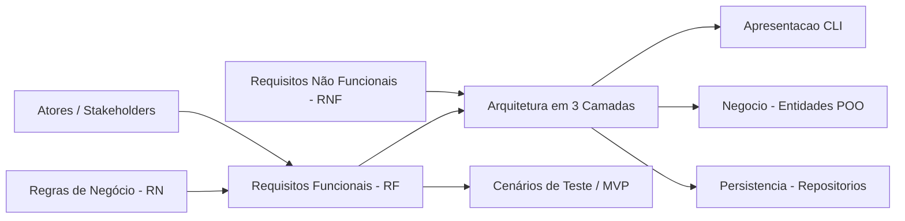

# Matriz de Rastreabilidade de Requisitos (RTM)
## Sistema de Gestão de Eventos Acadêmicos

---

### Histórico de Revisões
| Data | Versão | Descrição | Autor |
| :--- | :--- | :--- | :--- |
| 05/11/2026 | 1.0 | Criação da Matriz de Rastreabilidade de Requisitos (RTM) correlacionando Requisitos Funcionais, Regras de Negócio, Requisitos Não Funcionais, Camadas da Arquitetura e Cenários de Validação. | Engenharia de Software |

---

## 1. Finalidade e Estrutura da RTM

A **Matriz de Rastreabilidade de Requisitos (Requirements Traceability Matrix - RTM)** é o instrumento de governança que estabelece a conexão bidirecional (*forward* e *backward traceability*) entre:
- **Atores** (Perfis de Usuários);
- **Requisitos Funcionais (RF01 a RF18)** e seus níveis de prioridade (**MoSCoW**);
- **Regras de Negócio (RN01 a RN25)** que regem o comportamento do sistema;
- **Requisitos Não Funcionais (RNF01 a RNF08)** com suas restrições arquiteturais e de qualidade;
- **Elementos de Código e Camadas C#** (`Apresentacao`, `Negocio`, `Persistencia`);
- **Critérios de Validação e Escopo** (identificando o que compõe o **MVP**).

---

## 2. Matriz Principal de Rastreabilidade (RF × RN × POO × Camadas × MVP)

Esta seção mapeia cada **Requisito Funcional (RF)** aos seus respectivos requisitos de negócio, componentes conceituais e implementação nas 3 camadas da arquitetura.

| ID | Requisito Funcional | Prioridade | Ator Principal | Regras de Negócio Vinculadas | Camada Negócio (Entidades e Métodos POO) | Camada Apresentação (Console CLI) | Camada Persistência (Repositórios) | Escopo MVP |
| :--- | :--- | :--- | :--- | :--- | :--- | :--- | :--- | :---: |
| **RF01** | **Cadastrar Evento** | Must Have | Organizador | RN01, RN12 | `Evento`, construtor validado, métodos de validação de datas e capacidade | `MenuEventos.CadastrarEvento()` | `EventoRepositorio.Inserir()` | Sim |
| **RF02** | **Listar/Consultar Eventos** | Must Have | Organizador / Participante | RN13 (filtros de status) | `Evento`, `StatusEvento`, consultas de status | `MenuEventos.ListarEventos()`, `MenuEventos.VisualizarDetalhes()` | `EventoRepositorio.ObterTodos()`, `EventoRepositorio.ObterPorId()` | Sim |
| **RF03** | **Alterar Dados do Evento** | Must Have | Organizador | RN01, RN08, RN12 | `Evento.AtualizarDados()`, validação de estado não terminal | `MenuEventos.EditarEvento()` | `EventoRepositorio.Atualizar()` | Sim |
| **RF04** | **Alterar Status do Evento** | Must Have | Organizador | RN08, RN13 | `Evento.AlterarStatus()`, máquina de estados de `StatusEvento` | `MenuEventos.AlterarStatusEvento()` | `EventoRepositorio.Atualizar()` | Sim |
| **RF05** | **Cadastrar Atividade em Evento** | Must Have | Organizador | RN02, RN08, RN15, RN18 | `Evento.AdicionarAtividade()`, `Atividade`, `TipoAtividade` | `MenuAtividades.CadastrarAtividade()` | `EventoRepositorio.Atualizar()` (Composição 1:N) | Sim |
| **RF06** | **Listar Atividades do Evento** | Must Have | Organizador / Participante | RN02, RN15 | `Evento.Atividades`, `Atividade` | `MenuAtividades.ListarAtividades()` | `EventoRepositorio.ObterPorId()` | Sim |
| **RF07** | **Remover/Editar Atividade** | Should Have | Organizador | RN02, RN08, RN15, RN18, RN24 | `Evento.RemoverAtividade()`, `Evento.EditarAtividade()`, consulta a inscritos ativos | `MenuAtividades.EditarRemoverAtividade()` | `EventoRepositorio.Atualizar()`, `InscricaoRepositorio.ExisteInscricaoNaAtividade()` | Não |
| **RF08** | **Cadastrar Participante** | Must Have | Participante / Organizador | RN09, RN10, RN11 | `Participante`, construtor com validação de CPF, e-mail e dados obrigatórios | `MenuParticipantes.CadastrarParticipante()` | `ParticipanteRepositorio.Inserir()`, verificação de unicidade | Sim |
| **RF09** | **Listar e Buscar Participantes** | Must Have | Organizador | RN09, RN10 | `Participante` | `MenuParticipantes.ListarParticipantes()`, `MenuParticipantes.BuscarPorCpf()` | `ParticipanteRepositorio.ObterTodos()`, `ParticipanteRepositorio.ObterPorCpf()` | Sim |
| **RF10** | **Atualizar Dados do Participante** | Should Have | Participante / Organizador | RN09, RN10, RN11 | `Participante.AtualizarDados()`, validação de unicidade e campos | `MenuParticipantes.EditarParticipante()` | `ParticipanteRepositorio.Atualizar()` | Não |
| **RF11** | **Inscrever Participante no Evento** | Must Have | Participante | RN03, RN04, RN14 | `Inscricao`, `Evento.TemVagasDisponiveis()`, validação de período aberto e unicidade | `MenuInscricoes.InscreverEmEvento()` | `InscricaoRepositorio.Inserir()`, verificação de duplicidade | Sim |
| **RF12** | **Inscrever em Atividade Específica** | Should Have | Participante | RN05, RN06, RN16, RN17 | `Inscricao.InscreverAtividade()`, `Atividade.TemVagas()`, verificação de choque de horário | `MenuInscricoes.InscreverEmAtividade()` | `InscricaoRepositorio.Atualizar()` | Não |
| **RF13** | **Cancelar Inscrição** | Must Have | Participante / Organizador | RN08, RN19, RN20 | `Inscricao.Cancelar()`, liberação de vagas em cascata, validação de prazo | `MenuInscricoes.CancelarInscrição()` | `InscricaoRepositorio.Atualizar()` | Sim |
| **RF14** | **Consultar Minhas Inscrições** | Should Have | Participante | RN04, RN05 | `Inscricao`, `StatusInscricao` | `MenuInscricoes.ListarMinhasInscricoes()` | `InscricaoRepositorio.ObterPorParticipanteId()` | Não |
| **RF15** | **Registrar Presença (Check-in)** | Must Have | Operador de Credenciamento | RN21, RN22, RN23 | `Inscricao.ConfirmarPresenca()`, verificação de evento `EmAndamento` e idempotência | `MenuCredenciamento.RegistrarCheckIn()` | `InscricaoRepositorio.Atualizar()` | Sim |
| **RF16** | **Emitir Comprovante / Certificado** | Should Have | Participante / Organizador | RN07, RN25 | `CertificadoServico` ou `Inscricao.EmitirCertificado()`, validação de presença e carga horária | `MenuCertificados.EmitirCertificado()` | Leitura cruzada em `InscricaoRepositorio` e `EventoRepositorio` | Não |
| **RF17** | **Relatório de Participantes por Evento** | Must Have | Organizador | RN03, RN04, RN21 | Junção de dados de `Evento`, `Inscricao` e `Participante` | `MenuRelatorios.ExibirInscritosPorEvento()` | `InscricaoRepositorio.ObterPorEventoId()`, `ParticipanteRepositorio.ObterPorId()` | Sim |
| **RF18** | **Relatório de Ocupação de Vagas** | Should Have | Organizador | RN03, RN12, RN15, RN17 | Cálculos de taxa de ocupação em `Evento` e `Atividade` | `MenuRelatorios.ExibirTaxaOcupacao()` | `EventoRepositorio.ObterTodos()`, contagem em `InscricaoRepositorio` | Não |

---

## 3. Matriz Reversa de Regras de Negócio (RN × Entidades × RFs Impactados)

Esta matriz demonstra como cada **Regra de Negócio (RN)** se apoia nos conceitos de Orientação a Objetos e quais **Requisitos Funcionais** são impactados caso ela seja violada.

| ID | Nome da Regra de Negócio | Módulo | Severidade | Entidades / Métodos de Domínio (POO) | Requisitos Impactados | Efeito da Violação |
| :--- | :--- | :--- | :--- | :--- | :--- | :--- |
| **RN01** | Validação de Cronograma do Evento | Eventos | Crítica | `Evento` (construtor / validação de datas) | RF01, RF03 | Bloqueia criação/edição se `DataFim <= DataInicio` ou evento no passado. |
| **RN02** | Conflito de Atividades com o Evento | Atividades | Crítica | `Evento.AdicionarAtividade()`, `Atividade.ValidaHorario()` | RF05, RF06, RF07 | Bloqueia atividade fora do intervalo `[DataInicio, DataFim]` do evento. |
| **RN03** | Limite de Capacidade (Vagas) no Evento | Inscrições | Crítica | `Evento.TemVagasDisponiveis()`, `Inscricao` | RF11, RF17, RF18 | Bloqueia nova inscrição se total de inscritos ativos $\ge$ `CapacidadeMaxima`. |
| **RN04** | Unicidade de Inscrição no Evento | Inscrições | Crítica | `Inscricao` / Repositório de Inscrições | RF11, RF14, RF17 | Bloqueia duplicação de inscrição para o mesmo participante no evento. |
| **RN05** | Inscrição em Atividades Dependentes | Inscrições | Crítica | `Inscricao.InscreverAtividade()` | RF12, RF14 | Bloqueia inscrição em atividade se o participante não estiver inscrito no evento pai. |
| **RN06** | Conflito de Horários entre Atividades | Inscrições | Alta | `Inscricao.ValidarChoqueHorario()` | RF12 | Bloqueia inscrição simultânea do mesmo participante em atividades sobrepostas. |
| **RN07** | Elegibilidade para Certificado | Certificação | Média | `Inscricao.PodeEmitirCertificado()`, `StatusEvento` | RF16 | Impede emissão se presença não foi confirmada ou se o evento não estiver `Concluido`. |
| **RN08** | Restrição de Operações em Evento Encerrado | Eventos / Inscrições | Crítica | `Evento.GarantirModificavel()`, `Inscricao` | RF03, RF04, RF05, RF07, RF13 | Bloqueia mutações cadastrais e cancelamentos se evento for `Concluido` ou `Cancelado`. |
| **RN09** | Validação e Unicidade de CPF | Participantes | Crítica | `Participante` (validador de CPF) | RF08, RF09, RF10 | Rejeita CPF com formato inválido ou já existente na base. |
| **RN10** | Validação e Unicidade de E-mail | Participantes | Alta | `Participante` (validador de formato de e-mail) | RF08, RF09, RF10 | Rejeita e-mail em formato inválido ou já existente na base. |
| **RN11** | Obrigatoriedade de Dados do Participante | Participantes | Alta | `Participante` (campos obrigatórios não nulos) | RF08, RF10 | Impede criação/atualização de participante com Nome, CPF ou E-mail em branco. |
| **RN12** | Capacidade e Carga Horária Positivas | Eventos | Alta | `Evento` (validação numérica) | RF01, RF03, RF18 | Rejeita valores $\le 0$ ou redução de capacidade abaixo dos inscritos ativos. |
| **RN13** | Transições de Status Permitidas | Eventos | Crítica | `Evento.AlterarStatus()`, `StatusEvento` | RF02, RF04 | Impede saltos de status ilegais (ex.: de `Previsto` direto para `Concluido`). |
| **RN14** | Período Hábil para Inscrição no Evento | Inscrições | Crítica | `Evento.PermiteInscricoes()`, `Inscricao` | RF11 | Permite inscrição exclusivamente se o status for `InscricoesAbertas`. |
| **RN15** | Capacidade Máxima da Atividade | Atividades | Alta | `Atividade` (validação de vagas) | RF05, RF06, RF07, RF18 | Vagas da atividade devem ser $> 0$, $\le$ capacidade do evento e $\ge$ inscritos atuais. |
| **RN16** | Unicidade de Inscrição na Atividade | Inscrições | Crítica | `Inscricao.InscreverAtividade()` | RF12 | Bloqueia participante de se inscrever duas vezes na mesma atividade. |
| **RN17** | Limite de Vagas em Atividade Específica | Inscrições | Crítica | `Atividade.TemVagasDisponiveis()`, `Inscricao` | RF12, RF18 | Rejeita inscrição em atividade com vagas esgotadas. |
| **RN18** | Conflito de Local/Sala entre Atividades | Atividades | Média | `Evento.ValidarConflitoLocalAtividades()` | RF05, RF07 | Impede alocação da mesma sala/local para duas atividades em horários concorrentes. |
| **RN19** | Cancelamento de Inscrição em Cascata | Inscrições | Alta | `Inscricao.Cancelar()` | RF13 | Ao cancelar inscrição no evento, remove e libera vagas de todas as atividades associadas. |
| **RN20** | Prazo Limite para Cancelamento | Inscrições | Média | `Inscricao.ValidarPrazoCancelamento()` | RF13 | Bloqueia cancelamento de inscrição após o início do evento (`DataInicio`). |
| **RN21** | Janela de Registro de Presença | Presença | Alta | `Inscricao.ConfirmarPresenca()` | RF15, RF17 | Check-in permitido exclusivamente com o evento com status `EmAndamento`. |
| **RN22** | Unicidade de Check-in (Idempotência) | Presença | Alta | `Inscricao.PresencaConfirmada` | RF15 | Notifica se presença já havia sido confirmada anteriormente sem duplicar registros. |
| **RN23** | Check-in Exclusivo para Inscrição Ativa | Presença | Crítica | `Inscricao.ConfirmarPresenca()` | RF15 | Bloqueia tentativa de credenciamento em inscrições com status `Cancelada`. |
| **RN24** | Bloqueio de Exclusão de Atividade com Inscritos | Atividades | Alta | `Evento.RemoverAtividade()` | RF07 | Impede exclusão de atividade se houver participante inscrito nela. |
| **RN25** | Carga Horária Certificada Fiel ao Evento | Certificação | Alta | `Inscricao.EmitirCertificado()`, `Evento` | RF16 | Garante que o total de horas do certificado reflita com exatidão a carga cadastrada. |

---

## 4. Matriz de Rastreabilidade de Requisitos Não Funcionais (RNF)

Esta matriz mapeia os **Requisitos Não Funcionais (RNF)** para as decisões arquiteturais da solução e seus mecanismos de verificação.

| ID | Categoria | Descrição Sucinta | Diretriz de Implementação C# / POO | Mecanismo de Verificação |
| :--- | :--- | :--- | :--- | :--- |
| **RNF01** | **Arquitetura em 3 Camadas** | Separação estrita entre `Apresentacao`, `Negocio` e `Persistencia`. | Referências de projetos unidirecionais configuradas no `.csproj` e descritas em `docs/01-primeiros-passos-e-camadas.md`. | Compilação da solução com `dotnet build`; inspeção de dependências em `SistemaGestaoEventosAcademicos.slnx`. |
| **RNF02** | **Plataforma e Tecnologia** | C# sobre .NET 8 (ou superior) multiplataforma. | Target Framework `<TargetFramework>net8.0</TargetFramework>` ou net9.0 em todos os `.csproj`. | Execução com `dotnet --version` e `dotnet run` em macOS, Linux e Windows. |
| **RNF03** | **Interface CLI (Console)** | Navegação por menus no terminal com opções de retorno. | `ConsoleHelper`, loops de menu `while`, leitura estruturada `Console.ReadLine()`. | Testes manuais de usabilidade no terminal. |
| **RNF04** | **Resiliência e Exceções** | Sem encerramento abrupto (*crash*) por erros de entrada. | Blocos `try/catch` nas fronteiras da camada de apresentação; conversões com `int.TryParse` e `DateTime.TryParse`. | Teste de estresse com entradas vazias, caracteres alfanuméricos em campos de data e números. |
| **RNF05** | **Princípios de POO** | Encapsulamento, métodos ricos, composição e associação. | Classes de domínio sem modelos anêmicos; `Evento` compõe `Atividade`; `Inscricao` associa `Participante` e `Evento`. | Revisão estática de código e inspeção do modelo conceitual (Mermaid). |
| **RNF06** | **Persistência de Dados** | Inicialmente em memória, desacoplada e extensível. | Classes de repositório (`EventoRepositorio`, etc.) manipulando coleções `List<T>` internas sem acoplamento à UI. | Facilidade de substituir a persistência por arquivos JSON sem tocar em `Negocio`. |
| **RNF07** | **Manutenibilidade e Clean Code** | Padrões de nomenclatura C# (PascalCase, camelCase). | Adoção de convenções Microsoft C# e nomes de métodos expressivos de negócio. | Revisão de código / analisadores de estilo .NET. |
| **RNF08** | **Desempenho** | Operações executadas em menos de 1 segundo para o volume acadêmico. | Algoritmos com complexidade eficiente em memória ($O(1)$ a $O(n)$ via LINQ). | Medição de tempo de resposta em operações de busca e relatório. |

---

## 5. Matriz de Cobertura de Verificação e Cenários de Teste

A tabela a seguir orienta a validação funcional (casos de teste manuais e automatizados) para garantir a cobertura de cada requisito e regra de negócio no MVP:

| Caso de Teste | Requisitos / Regras Testadas | Descrição do Cenário de Teste | Resultado Esperado |
| :--- | :--- | :--- | :--- |
| **CT01** | RF01, RN01, RN12 | Cadastrar evento com `DataFim < DataInicio` ou capacidade zero. | Operação rejeitada com mensagem clara; nenhum evento persistido. |
| **CT02** | RF01, RF02 | Cadastrar evento com datas e capacidade válidas e listá-lo. | Evento cadastrado com sucesso e listado com status inicial `Previsto`. |
| **CT03** | RF04, RN13 | Alterar status do evento de `Previsto` para `InscricoesAbertas`. | Status atualizado com sucesso. |
| **CT04** | RF08, RN09, RN10, RN11 | Cadastrar participante com CPF repetido ou formato inválido. | Cadastro bloqueado informando a duplicidade/invalidação do CPF. |
| **CT05** | RF11, RN14 | Tentar inscrever participante em evento com status `Previsto` ou `Concluido`. | Inscrição bloqueada: evento não está com inscrições abertas. |
| **CT06** | RF11, RN03 | Realizar inscrições até esgotar a `CapacidadeMaxima` do evento e tentar mais uma. | Inscrição excedente recusada por esgotamento de vagas. |
| **CT07** | RF11, RN04 | Tentar inscrever o mesmo participante duas vezes no mesmo evento. | Inscrição duplicada bloqueada. |
| **CT08** | RF13, RN19, RN20 | Cancelar inscrição antes do início do evento. | Inscrição marcada como cancelada e vaga restituída ao evento. |
| **CT09** | RF15, RN21, RN23 | Tentar registrar presença com evento em `Previsto` ou com inscrição cancelada. | Check-in bloqueado informando que o evento precisa estar `EmAndamento` e a inscrição ativa. |
| **CT10** | RF15, RN22 | Registrar presença em evento `EmAndamento` duas vezes seguidas para o mesmo inscrito. | Primeira confirmação registrada com sucesso; segunda tentativa informa que a presença já fora confirmada. |
| **CT11** | RF17 | Gerar relatório de inscritos de um evento após inscrições e check-ins. | Relatório exibe lista de nomes, CPFs, status da inscrição e indicador de presença confirmado. |

---

## 6. Sumário Quantitativo e Conformidade de Rastreabilidade

- **Total de Requisitos Funcionais (RF):** 18
  - **Must Have (MVP):** 10 (RF01, RF02, RF03, RF04, RF05, RF06, RF08, RF09, RF11, RF13, RF15, RF17)*
  - **Should Have (Pós-MVP):** 8 (RF07, RF10, RF12, RF14, RF16, RF18)
- **Total de Regras de Negócio (RN):** 25
  - **Cobertura de RNs por RFs:** 100% (todas as 25 regras possuem pelo menos 1 RF associado).
  - **Cobertura de RFs por RNs:** 100% (todos os 18 RFs possuem amarração com regras ou políticas de negócio).
- **Total de Requisitos Não Funcionais (RNF):** 8 (todos mapeados para componentes arquiteturais).

---
*\* Nota: RF01 a RF06, RF08, RF09, RF11, RF13, RF15 e RF17 formam o núcleo essencial e verificável da primeira entrega funcional.*

